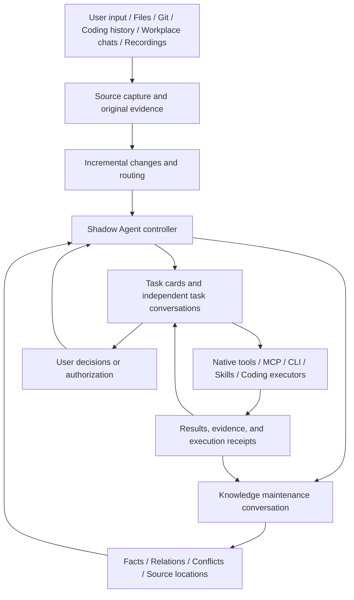

<div align="center">

# Shadow Agent

**English** | [简体中文](README.zh-CN.md)

### Personal memory and continuous task progress

Turn information into evidence-backed knowledge, and requests into work that can be followed through.

**Local-first · Traceable knowledge · Independent task conversations · Controlled capability growth**

[How it works](#how-it-works) · [Knowledge](#evidence-backed-updatable-knowledge) · [Tasks](#one-task-one-card) · [Extensions](#how-capabilities-grow) · [Getting started](#getting-started) · [Onboarding](#onboarding-from-context-to-action)

</div>

> **Windows-first and under active development.** A model account and local runtime setup are required. Voice and workplace integrations are optional. Start with a small task, then gradually expand access to sources and actions.
>
> **Security:** The current runtime template grants broad local file and execution access. Source scopes, human review, and application policies are not an operating-system sandbox. Start in a separate Windows user account or test environment, without connecting critical data or equipment that cannot tolerate mistakes.

## What it does

Shadow Agent is built for work whose context is scattered across chats, files, repositories, coding sessions, and spoken conversations. Tasks may span days, change direction, or become unnecessary because someone else has already handled them.

The goal is to reduce more than typing and searching: repeated explanations, finding supporting material, manually chasing progress, and maintaining the same knowledge in multiple places.

| Capability | What it helps with | Current boundary |
|---|---|---|
| Evidence-backed personal knowledge | Responsibilities, collaborators, projects, decisions, and source locations | Stored information is not automatically trustworthy |
| Revisable memory | New evidence can extend, contradict, or revise earlier understanding | Arrival order alone does not decide truth; model judgments can be wrong |
| Persistent task cards | Goals, acceptance criteria, progress, evidence, and blockers | A child executor finishing does not mean the task is complete |
| Information-to-task updates | Meeting outcomes, chat changes, and corrections can reach related tasks | Relevance requires judgment; not every message is automatically matched |
| Delegated coding | The controller can delegate to a separate coding executor and verify its output | Backend interfaces, authentication, and permissions must be connected |
| Capability growth | Investigate and integrate MCP servers, CLIs, Skills, or focused code changes within a task | Discovery, configuration, and successful business use are separate checks |
| Voice and speaker annotation | Recordings become information with timestamps, audio references, and speaker candidates | Voiceprints are not authorization; mixed speech and transcription errors need review |
| Replaceable models | Configure controller and coding-executor models independently | Changing models does not migrate the knowledge base; existing session bindings still need checking |

## How it works



Input channels and execution tools are not the center of the system. It is organized around three questions: **What do we know? What are we doing? What supports the claim that it is complete?**

OpenClaw provides runtime facilities such as models, sessions, tools, and native Workboard. Shadow Agent defines personal knowledge, information routing, task ownership, progression, and verification. It does not put all work into one ever-growing chat.

## Evidence-backed, updatable knowledge

### Remember facts, their evidence, and how they change

| Layer | What it stores | Why it matters |
|---|---|---|
| Original evidence | Input text, source identity, event and capture times, retrievable locations | Return to the source and distinguish a statement from model inference |
| Entities and facts | People, projects, documents, repositories, and evidence-linked relationships | Answer who is responsible, what is related, and where to investigate |
| Revisions and conflicts | Supporting and opposing evidence, scope, validity periods, supersession history | Keep contradictory or outdated information from becoming one unqualified conclusion |
| Retrieval entry points | Lexical indexes, graph relationships, document, conversation, and repository locations | Find an entry point, then read the original material needed for the task |
| Personal profile | A bounded fact view and private `USER.md`, derived from the same graph | Provide current context without maintaining a second personal database |

Ask what is currently known, then follow the source references. Current understanding and historical records remain distinguishable, with evidence available for correction.

### How knowledge is updated

1. **Preserve new input.** User statements, changes from connected sources, voice corrections, and task results retain their sources and timestamps.
2. **Use one maintenance workflow.** Information with lasting value goes to the knowledge maintenance conversation. Task conversations may propose knowledge changes rather than maintain separate facts.
3. **Compare with existing knowledge.** Determine whether the input adds information, repeats it, conflicts with it, or revises the same claim, retaining the evidence.
4. **Write and read back.** Persist maintenance results, evidence links, and review receipts. A completed review does not automatically make a fact trustworthy.
5. **Use it in later work.** Regenerate the personal profile from the graph and route relevant changes through the task workflow. Later queries can trace both new and old evidence.

**Received later does not necessarily mean more current.** Event time, source version, scope, and meaning all matter. When the relationship cannot be established reliably, keep a conflict or an unresolved question instead of silently overwriting knowledge.

<details>
<summary><strong>Example: a meeting changes ownership and the plan</strong></summary>

Suppose a meeting confirms that a colleague will handle acceptance testing and that offline validation should come first. The transcript and speaker corrections retain their source. The controller determines which active tasks are affected, supplies the new information to those tasks, and sends reusable responsibilities and decisions to knowledge maintenance.

The task card still owns execution and acceptance. It can propose additional knowledge, but routing the same meeting outcome through a task does not create a second independently maintained set of facts. Earlier evidence remains available to explain the change.

Use recording annotations or the task card to clarify transcription mistakes, unknown speakers, or unclear responsibility.

</details>

### What happens when the first search misses?

Current retrieval uses **lexical search, graph relationships, and source entry points**. You do not have to remember an exact filename: describe the problem, let the Agent find a related project, document, or conversation, and continue from there.

The Agent can follow document, conversation, repository, or module references to search further, read originals, inspect commits, and examine related files. Success means obtaining the necessary evidence and completing the request, not achieving a 100% first-search hit rate.

Retrieval cannot invent missing originals, inaccessible account data, or uncaptured material. Such gaps should be reported, not disguised as a supported answer because similar content was found.

## One task, one card

Use the main conversation to assign work, ask questions, and correct understanding. Use a task card to follow one specific piece of work. Each card has its own controller conversation and can query related tasks and knowledge without sharing every task's full history.

| Surface | What to do there |
|---|---|
| Main conversation | Assign work, correct a responsibility, or discuss priorities |
| Follow-up in a task card | Add material, change the plan, ask for progress, or revise acceptance criteria |
| Needs you | Supply missing information, authorize an action, make a decision, or verify a result |
| Complete / Terminate | End the task with an optional note; termination must not be reported as achieving the goal |
| Voice and people | Listen back, edit transcripts, confirm people, and maintain voiceprint samples |

New messages, source changes, user feedback, task results, and recovery checks can trigger further processing. The Agent cannot claim to be continuously executing when the computer is off, the controller is offline, a source is disconnected, or automatic checks are disabled.

After you add information to a card, the Agent decides whether to continue, adjust, or replan. A running coding executor may read the update in its next turn. For important changes, check subsequent progress rather than treating an acknowledgment as proof of adoption.

## How capabilities grow

You can assign integration work as an ordinary task, for example:

> I want to query project documents in this system. First check for an official MCP server or CLI and connect it read-only. Find the requested document, read the original, and tell me what is still missing.

| Need | Preferred approach | Core changes usually required? |
|---|---|---|
| Reusable steps for existing tools | Write or connect a workspace Skill | No |
| A service with MCP or CLI support | Connect its native service, authentication, and tools | No, but runtime and permissions need validation |
| A missing focused tool | Delegate implementation and testing to a coding executor | Usually not |
| A different reasoning model | Configure the native provider and model roles | Usually not |
| A new continuous message or event source | Implement source identity, incremental capture, timestamps, deduplication, and recovery contracts | Source integration code is needed |
| Different knowledge or task semantics | Change the core, contracts, and regression tests | Yes |

An MCP integration can be prepared, probed, enabled, or rolled back. Probing runs a program or connects to a service, so check its trustworthiness first. After enabling it, verify a real business operation. New external writes require appropriate authorization.

For changes to core code or running services, the Agent should explain the plan, test results, and switching impact before deploying within its authorization. Missing accounts or unavailable software interfaces remain explicit requirements.

See [Capability integration and model selection](docs/operations/capability-growth.md).

## Getting started

**Start with [Installation and first run](docs/getting-started.md).** `npm install` installs this Node/Electron project's dependencies; it does not configure OpenClaw, the Codex plugin, model login, or voice processing.

The README is available in English and Simplified Chinese. Most linked setup and technical documents are currently in Chinese.

| Component | Current requirement |
|---|---|
| Operating system | Desktop and startup scripts are primarily validated on Windows x64 / PowerShell |
| Node.js | The package declares `>=22`; existing startup scripts look for project-local Node `24.19.0` |
| OpenClaw | Runtime patches are pinned to `2026.8.1`; upgrades need revalidation |
| Controller model | A configured, callable model backend with the required tool capabilities |
| Coding executor | Codex by default; managed app-server scripts require `>=0.149.0` |
| Workplace software | Optional; connect each CLI/MCP, account, and authorization separately |
| Voice | Optional; install Python, ASR/VAD/voiceprint dependencies, and models separately |

Prepare dependencies and local configuration in a **new, separate directory**, then initialize the local database:

```powershell
npm ci
npm run init
```

Follow the installation guide to configure OpenClaw, plugins, and model login, then start the backend and desktop. Once the main conversation responds, proceed with personal onboarding below.

## Onboarding: from context to action

### 1. Start with essential information

Tell the Agent or setup assistant:

- Your preferred name, role, and team.
- Which work you own, and which work you do not.
- The first goal you want help with.
- Which applications, directories, or conversations it may read, and which should remain disconnected.
- Optional collaboration preferences. **Do not include passwords, tokens, or cookies in this profile.**

Use the private `config/user-basics.local.json`, following the [basic information example](config/user-basics.example.json). Replace the sample with your own information before removing its `exampleOnly` marker.

### 2. Preview work for you and the Agent

```powershell
node scripts/user-profile.mjs preview --file config/user-basics.local.json
```

Preview does not write to the database. It shows the profile, onboarding task plan, and confirmation hash. Depending on your selected sources, tasks may include:

| Task | Owner | Completion criteria |
|---|---|---|
| Clarify responsibilities and collaborators | You | Fill gaps in ownership, delegation, and collaboration without re-entering known facts |
| Confirm readable sources and scope | You | Confirm sources first; do not assume full-disk access |
| Connect or log into a selected application | You | Authorize through the application's secure entry point and verify the required read-only access |
| Investigate selected material and organize knowledge | Agent | Inspect directories and indexes, select relevant material, retain facts, locations, and questions |
| Configure and validate voice input | Agent, with your participation | Added only when voice is selected; configure for the device, preferences, and real tests |
| Advance your first goal | Agent | Establish acceptance criteria and work on an independent task card |

There is no fixed number of mandatory onboarding tasks. An unavailable source should not block independent sources that are ready.

### 3. Confirm and use the same task system

```powershell
# Review the profile and plan, then replace the placeholder with the full preview hash.
node scripts/user-profile.mjs confirm --file config/user-basics.local.json --confirm YOUR_PREVIEW_HASH
node scripts/user-profile.mjs status
node scripts/user-profile.mjs sync
```

Confirmation stores the basic information and queues onboarding. When the controller processes the request, it creates onboarding cards in the task list. If offline, the request remains available for later processing.

Replaying the same confirmation is idempotent and does not enqueue duplicates. The profile file is an import input: editing it does not bypass knowledge maintenance to rewrite long-term understanding.

**There is no separate first-run wizard yet.** Basic information is handled through the main conversation and CLI preview/confirmation. Onboarding uses the existing task workflow, not another task database.

### 4. Refine knowledge through actual use

Source investigations, task feedback, and corrections update the same graph through knowledge maintenance. `USER.md` is an automatically generated personal profile, not a second manually maintained database. Edits to that view enter maintenance as input requiring review.

See [User knowledge and onboarding](docs/operations/user-knowledge-onboarding.md).

## Voice uses the same information workflow

```text
Computer recording / Phone transfer packages / Existing audio
    -> Reception and integrity checks
    -> Bounded assembly, VAD, and recognition windows
    -> Transcript, local speakers, and cross-window voiceprint candidates
    -> Human corrections / Evidence
    -> Related tasks + Unified knowledge maintenance
```

- Align events by **recording time**, not by the time the phone returns and transfers its files.
- Local routes include SenseVoice, Fun-ASR-Nano, and MOSS. Currently, `auto-local` prefers Fun and falls back to SenseVoice according to policy; MOSS must be selected explicitly.
- MOSS produces local speaker labels. `S01` in two different windows does not establish the same person; use voiceprint candidates or human confirmation.
- Annotate only the people and excerpts that matter. You do not have to name every speaker. Do not enroll a voiceprint from mixed speech without a clean sample.
- Annotation, voiceprint enrollment, and candidate rematching are separate actions. Speaker identity does not grant authorization.
- Failures, partial output, and uncertain boundaries retain their status rather than becoming claims of complete transcription.

Windows recording, Android portable recording, and existing audio import are supported. The phone captures and transfers audio; the computer performs recognition and speaker association. There is currently no iOS client.

| Option | Intended use |
|---|---|
| MOSS | Transcription with timestamps and local speaker information, with a usable NVIDIA GPU |
| Fun-ASR-Nano | Local speech recognition in a dedicated CUDA environment |
| SenseVoice | A CPU route or fallback for automatic local mode |
| External API | A cloud service whose upload and billing terms you accept, connected through an extension task |

Use the voice view to listen, correct text, and confirm speakers; use people and voiceprint management to listen to and manage samples. Annotate only the excerpts you care about. See [Voice models and device setup](docs/voice-guide.md).

## Everyday use and troubleshooting

| Symptom | What to check first |
|---|---|
| Recording works but the controller is offline | Capture and control are separate processes; inspect Gateway, model authorization, and pending queues |
| Onboarding is queued but there are no cards | Check whether the controller is online and consuming the original request; do not repeatedly recreate the profile |
| A task is waiting for you | Open the original card, inspect the missing information or authorization, and reply there |
| A new model seems to lack context | Check that knowledge and Workboard paths are unchanged and whether old sessions are pinned to the previous backend |
| A configured tool is unavailable | Verify discovery in a new turn, authentication, permissions, and an actual business operation |
| Similar content appears but the answer is unclear | Read the original, version, and scope; do not treat a search candidate as a confirmed fact |

After configuring the runtime, use `npm run status` for status and `npm run report:controller-runtime -- --hours 24` for recorded costs. `npm run doctor` initializes some directories/databases and probes dependencies; it is not a side-effect-free read-only audit.

The desktop `X` hides the interface; exiting through the system tray stops the managed backend. Avoid restarting every service to fix one window without understanding the impact.

## Data and permissions

Local-first does not mean fully offline. Remote model requests include the context and tool results needed for the turn. External MCP servers, CLIs, and cloud services have their own data flows.

This is not a multi-tenant security platform. High-privilege tools and third-party programs carry real risks. Users must explicitly decide account authorization, source access, model data handling, and external-action review.

## Relationship with OpenClaw

OpenClaw provides model invocation, sessions, tools, and native task facilities. Shadow Agent builds personal knowledge, task progression, desktop interaction, and voice workflows on top.

The project currently relies on a pinned OpenClaw version, plugins, and a small set of controlled patches. Check compatibility before upgrading; do not replace it with `latest` without validation.

See [Runtime dependencies](docs/runtime-dependencies.md) for versions, patches, and third-party notices.

Developers can start with [Architecture](docs/ARCHITECTURE.md), the [Project contract](docs/PROJECT_CONTRACT.md), and the [Source component guide](docs/release-contents.md).

## Current limitations

- Initial setup involves several runtime components; there is no one-click installer yet.
- Continuous progress requires the computer, backend, and required models to be online. Offline inputs wait for processing.
- Models can misunderstand responsibilities, tasks, and recordings. Human corrections and result verification remain important.
- Android background recording, Bluetooth proximity, and battery life depend on the device and OS. Gap-free phone/computer handover is not guaranteed.
- Long conversations and complex investigations can take time and consume substantial tokens. Configure models and reasoning levels by task type.

## License

Project-owned code is licensed under the [MIT License](LICENSE), permitting use, modification, and commercial distribution with the copyright and license notice retained. Third-party code and model weights remain under their own licenses; this project's MIT license does not relicense them.

See [Third-party notices](THIRD_PARTY_NOTICES.md) for OpenClaw, icons, and voice models.
