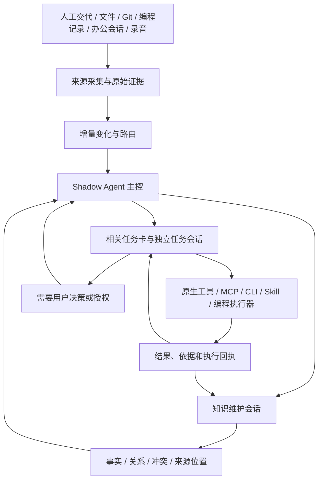

<div align="center">

# Shadow Agent

[English](README.md) | **简体中文**

### 影子智能体 · 记忆与持续推进

让信息成为有依据的知识，让交代成为可以持续跟进的工作。

**本机优先 · 可追溯知识 · 独立任务会话 · 受控能力扩展**

[工作方式](#工作方式) · [知识库](#有依据可更新的知识库) · [持续推进](#一项工作一张卡) · [能力扩展](#能力如何生长) · [开始使用](#开始使用) · [冷启动](#冷启动从认识你到开始工作)

</div>

> **Windows 优先，正在持续开发。** 使用前需要配置模型账号与本机运行环境；语音和办公软件按需接入。第一次使用建议从一个小任务开始，再逐步扩大资料和操作范围。
>
> **安全提醒：** 当前运行模板包含较高的本机文件与执行权限。来源范围、HITL 和业务策略不是操作系统沙箱。先在独立 Windows 用户或测试环境中使用，不要直接接入无法承受误操作的重要资料和设备。

## 它做什么

Shadow Agent 面向这样的工作：信息分散在聊天、文件、仓库、编程会话和口头交流里，任务会跨天变化，也会因为别人已经处理、方案调整或你改变决定而需要重新判断。

它希望减少的，不只是打字和检索，而是反复解释背景、寻找依据、手工追问进度和重复整理知识的工作。

| 能力 | 使用中的意义 | 当前边界 |
|---|---|---|
| 有来源的个人知识库 | 记住职责、协作关系、项目、决策及资料位置 | 保存了内容不等于内容已经可信 |
| 可修订记忆 | 新证据可以补充、反驳或修订旧认识 | 不按“最后收到”直接覆盖，不保证模型判断永远正确 |
| 持续任务卡 | 每项工作保留目标、验收、进展、依据和阻塞 | 子执行器结束不等于任务完成 |
| 信息与任务联动 | 会议结论、聊天变化和人工纠正进入相关任务 | 相关性需要判断，不承诺所有消息都自动匹配 |
| 编程任务委托 | 主控可委托独立编程执行器并核验产物 | 后端接口、认证和权限需实际接通 |
| 能力扩展 | 在任务内调查并接入 MCP、CLI、Skill 或局部代码 | 发现工具、配置成功、业务成功分开验收 |
| 语音输入与人物标注 | 录音成为带时间、原音频入口和说话人候选的信息 | 声纹不是身份授权，混合说话和识别错误需要复核 |
| 可替换模型 | 主控与编程执行器可以独立选择模型 | 换模型不迁移知识库，但旧会话绑定仍需核对 |

## 工作方式



输入渠道和执行工具不是系统的中心。系统围绕三件事组织：**知道了什么、正在做什么、凭什么认为完成了。**

OpenClaw 提供模型、会话、工具和原生 Workboard 等运行设施；Shadow Agent 定义个人知识、信息路由、任务归属、推进和核验规则。它不是把所有工作塞进一个不断变长的聊天。

## 有依据、可更新的知识库

### 记住事实，也记住依据和变化

| 层次 | 保存什么 | 用来做什么 |
|---|---|---|
| 原始证据 Evidence | 输入正文、来源标识、发生/采集时间、可回查位置 | 回到原始依据，区分是谁说的和模型推断 |
| 实体与事实 | 人、项目、文档、仓库及它们之间有来源的关系 | 回答“谁负责”“什么关联”“去哪里查” |
| 修订与冲突 | 支持/反对证据、适用范围、有效期、取代历史 | 避免把相互矛盾或已经过时的信息混成一个结论 |
| 检索入口 | 词法索引、图谱关系、文档/会话/仓库位置 | 先找到入口，再按任务读取必要原文 |
| 个人简况 | 从同一图谱派生的有界事实视图与私有 `USER.md` | 给 Agent 当前背景，而不是另维护一份个人资料 |

你可以先问“目前知道什么”，再沿来源查看原文。当前认知与历史记录分开呈现，遇到冲突时保留依据，便于纠正。

### 知识如何更新

1. **保留新输入。** 人工说明、已接入的来源变化、语音纠正或任务结果先保存来源与时间。
2. **进入统一维护流程。** 有长期价值的信息交给知识维护会话；任务会话可以提出知识差量，不独立维护另一套事实。
3. **和既有知识比较。** 判断是补充、重复、冲突还是同一声明的修订，保留对应证据。
4. **写入并回查。** 维护结果、事实支持关系及复核回执持久化；处理完成不自动等同于事实可信。
5. **用于后续工作。** 个人简况从图谱重新生成，相关变化经现有任务链路传递；下一次查询可追查新旧依据。

**收到时间晚，不一定代表信息更新。** 发生时间、来源版本、作用域与证据含义都需要核对。无法可靠判定时，保留冲突或待确认项，而不是静默覆盖。

<details>
<summary><strong>例子：开会后负责人和方案改变了</strong></summary>

假设会议确认“由同事乙负责验收，先做离线验证”。录音转写和人物纠正保留为来源；主控判断哪些正在推进的任务受到影响，向任务提供新信息，同时把可复用的职责/决策交给知识维护。

任务卡仍负责实际推进和验收。它可以提出补充知识，但不因为同一条会议结论经过任务卡，就再建一套互相覆盖的事实。旧依据保留，便于解释认识为什么改变。

识别错误、未知人物和责任不清时，可以在录音标注或任务卡里补充说明。

</details>

### 搜索不到时怎么办

当前使用**词法检索、图谱关系和来源入口**。不必记住准确文件名，可以先描述问题，让 Agent 找到相关项目、资料或会话，再深入查看。

Agent 可以沿找到的文档、会话、仓库或模块入口继续检索、读取原文、查提交记录和相关文件。验收看它是否取得必要依据并完成请求，而不是要求首轮检索命中 100%。

原件不存在、账号不可读、资料没有采集时，检索不能凭空补齐。系统应说明缺口，不把“找到相似内容”包装成答案成立。

## 一项工作，一张卡

主对话用于交代、询问和纠正；任务卡用于持续处理一项具体工作。每张卡有自己的控制会话，可以查询相关任务和知识，但不需要共享所有任务的完整聊天历史。

| 在哪里 | 适合做什么 |
|---|---|
| 主对话 | “帮我做这件事”“这条职责理解错了”“我现在优先关注什么” |
| 任务卡的继续交代 | 补充材料、改变方案、询问进度或给出新的验收要求 |
| 需要你处理 | 补充确实缺少的信息、授权、作出决策或确认结果 |
| 完成 / 终止 | 结束任务并可选填写说明；终止不应冒充目标已完成 |
| 声音与人物 | 回听、修订转写、确认人物和维护声纹样本 |

新消息、来源变化、用户反馈、任务结果和恢复检查可以唤醒后续处理。电脑关闭、主控离线、来源未连接或自动巡检被关闭时，不能宣称 Agent 仍在持续执行。

在任务卡里补充新信息后，Agent 会根据新情况判断是继续、调整还是重新规划。正在执行的编程工作可能到下一轮才读取补充内容；重要变更请查看卡片中的后续进展，不要只凭一句“收到”判断已经生效。

## 能力如何生长

你可以把“接入一种新能力”作为普通任务交给 Agent，例如：

> 我希望能查询某个系统里的项目文档。先确认有没有官方 MCP 或 CLI，只读接入；找到指定文档并回查原文后，再告诉我还缺什么。

| 缺口 | 优先方式 | 是否通常需要改核心 |
|---|---|---|
| 已有工具，只缺复用步骤 | 写或接入工作区 Skill | 否 |
| 软件提供 MCP / CLI | 接入原生服务、认证和工具 | 否，但需验证运行及权限 |
| 缺少一个局部工具 | 委托编程执行器实现、测试 | 通常不需要 |
| 更换思考模型 | 原生 provider 和角色选择配置 | 通常不需要 |
| 新的持续消息/事件来源 | 实现来源身份、增量、时间、去重与恢复契约 | 需要来源接入代码 |
| 改知识或任务的基本语义 | 修改核心、契约和回归测试 | 是 |

新 MCP 可以先准备配置、探测，再启用或回滚。探测会实际运行程序或连接服务，接入前请确认来源可信；启用后仍需用一项真实业务验证。新增外部写入需要相应授权。

涉及核心代码或正在运行的服务时，Agent 应先说明方案、测试结果和切换影响，再按授权部署。需要账号或尚无接口的软件，会明确提出缺少的条件。

详见 [能力接入与模型切换](docs/operations/capability-growth.md)。

## 开始使用

**先读 [安装与首次运行](docs/getting-started.md)。** `npm install` 只安装当前 Node/Electron 工程依赖，不会自动完成 OpenClaw、Codex 插件、模型登录和语音环境配置。

| 组件 | 当前要求 |
|---|---|
| 操作系统 | 桌面与启动脚本以 Windows x64 / PowerShell 为主要验证环境 |
| Node.js | 包声明 `>=22`；既有启动脚本固定查找项目内 Node `24.19.0` |
| OpenClaw | 当前运行补丁锁定 `2026.8.1`，升级需重新验证 |
| 主控模型 | 已配置、可调用且具有相应工具能力的模型后端 |
| 编程执行器 | 默认 Codex；受管 app-server 脚本要求 `>=0.149.0` |
| 办公软件 | 可选；各自的 CLI/MCP、账号与授权需要单独连接 |
| 语音 | 可选；Python、ASR/VAD/声纹依赖及模型需要另外安装 |

在**新的独立目录**准备依赖和本机配置后，可以先初始化本地数据库：

```powershell
npm ci
npm run init
```

随后按安装指南完成 OpenClaw、插件和模型登录，启动后台与桌面。主对话能正常回复后，再进行下面的个人初始化。

## 冷启动：从认识你到开始工作

### 第一步：只问必要信息

告诉 Agent 或配置助手：

- 怎样称呼你，岗位和团队是什么。
- 哪些工作由你负责，哪些不归你负责。
- 第一个希望它帮你完成的目标。
- 允许读取哪些软件、目录或会话；哪些暂时不接入。
- 可选的协作偏好。**不在资料里填写密码、Token 或 Cookie。**

资料写入私有 `config/user-basics.local.json`，格式参考 [基本信息示例](config/user-basics.example.json)。示例中的 `exampleOnly` 必须在替换为自己的资料后删除。

### 第二步：预览你和 Agent 各自要做的事

```powershell
node scripts/user-profile.mjs preview --file config/user-basics.local.json
```

预览不写库。它列出资料、初始化任务计划和确认哈希。根据你选定的来源，计划可能包括：

| 任务 | 处理者 | 完成标准 |
|---|---|---|
| 补充职责边界和同事协作关系 | 你 | 不要求重填已知资料，补充缺失的负责/委派/协作边界 |
| 确认可读软件和资料范围 | 你 | 未选来源时先确认，不默认全盘扫描 |
| 完成某个软件接入或登录 | 你 | 在该软件安全入口授权，验证必要的只读能力 |
| 调查指定资料并整理知识 | Agent | 先看目录/索引，再按目标选取材料，保留事实、位置与疑问 |
| 配置并验收语音输入 | Agent，与用户配合 | 显式选择语音时才加入，按设备、偏好和真实试验配置 |
| 推进你的首个目标 | Agent | 在独立卡片澄清验收并实际推进 |

它不是强制每人生成固定数量的任务。一个来源没登录，不应阻止其他已经就绪的独立来源继续。

### 第三步：确认后进入同一套任务系统

```powershell
# 用刚才预览的完整哈希替换占位符；先人工核对资料及任务计划。
node scripts/user-profile.mjs confirm --file config/user-basics.local.json --confirm YOUR_PREVIEW_HASH
node scripts/user-profile.mjs status
node scripts/user-profile.mjs sync
```

确认后保存基本资料并安排初始化。主控在线处理后，会在任务列表中建立引导卡片；暂时离线时保留请求，恢复后继续。

同一确认可以幂等重放，不重复入队。资料文件只是导入输入，修改它不会绕过知识维护流程自动改写长期认知。

**当前没有独立首次启动弹窗。** 基本资料通过主对话与 CLI 预览/确认完成；引导任务复用现有任务链路，不另建初始化任务库。

### 第四步：让知识从真实使用中完善

完成资料调查、任务反馈和人工纠正后，知识维护会话更新同一个图谱。`USER.md` 是自动生成的个人简况，不是第二个手工主数据库；修改这个视图会作为待复核输入进入维护流程。

详见 [用户知识与冷启动](docs/operations/user-knowledge-onboarding.md)。

## 语音也属于同一条信息链

```text
电脑录音 / 手机传输包 / 已有音频
    → 接收与完整性检查
    → 有界组装、VAD 与识别窗口
    → 转写、局部说话人及跨窗声纹候选
    → 人工修订 / Evidence
    → 相关任务 + 统一知识维护
```

- 按**录制时间**对齐事件，不把回到电脑传输的时间当成谈话发生时间。
- 可配置 SenseVoice、Fun-ASR-Nano 或 MOSS 本机路线；当前 `auto-local` 逻辑仍是 Fun 优先、不可用时按策略降级 SenseVoice，MOSS 需显式选择。
- MOSS 提供局部说话人结果；跨窗口不能直接用 `S01` 认定是同一人，需要声纹候选或人工确认。
- 可只标注有价值的人和片段，不强制给整段录音的所有人命名。混合说话且没有干净样本时，不强行登记声纹。
- 标注、保存声纹样本和重新匹配候选是不同操作；声音身份不是授权。
- 识别失败、部分输出和不确定边缘保留状态，不把不完整转写伪装成完整理解。

支持 Windows 电脑录音、Android 随行录音和已有音频导入。手机负责采集与传输，电脑负责识别和人物关联；当前没有 iOS 客户端。

| 选择 | 适合的需求 |
|---|---|
| MOSS | 希望在转写中同时得到时间和局部说话人信息，有可用 NVIDIA GPU |
| Fun-ASR-Nano | 侧重本机语音识别，使用独立 CUDA 环境 |
| SenseVoice | CPU 路线，或作为自动本机模式的后备 |
| 外部 API | 已有云服务并接受音频上传及计费，通过扩展任务接入 |

在“声音与人物”中回听、改字、确认人物；在“人员与声纹”中试听和管理样本。只标注你关心的片段即可。详见 [语音模型与两端配置](docs/voice-guide.md)。

## 日常使用与排障

| 现象 | 先检查 |
|---|---|
| 能录音但主控离线 | 采集与主控是不同进程；查看 Gateway、模型授权和待处理队列 |
| 初始化计划已排队但没有卡 | 查看主控是否在线、是否消费原请求；不要重复重新建档 |
| 任务等待你处理 | 打开原卡查看缺少的输入或授权，在同卡继续交代 |
| 新模型忘了背景 | 核对是否仍使用同一知识/Workboard 路径，旧会话是否 pin 到原后端 |
| 工具已配置但用不了 | 检查实际新轮次工具发现、认证、权限与一项真实业务操作 |
| 查到相似信息但答案不明确 | 继续回查原文、来源版本和范围，不把候选当确认事实 |

完成运行配置后可用 `npm run status` 查看状态，`npm run report:controller-runtime -- --hours 24` 查看已记录成本。`npm run doctor` 会初始化部分目录/数据库并探测依赖，不是完全无副作用的只读审计。

托盘 `X` 用于隐藏；托盘退出会停止受管后台。不要在不了解影响时用“重启全部服务”修复一个窗口问题。

## 数据与权限

本机优先不等于完全离线：使用远端模型时，模型请求会包含本轮需要的上下文和工具返回；外部 MCP、CLI 和云服务也有各自的数据流向。

本项目不是多租户安全平台；高权限工具及第三方程序具有真实风险。账号授权、来源选择、模型数据处理和外发审核需要由使用者明确决定。

## 与 OpenClaw 的关系

OpenClaw 提供模型调用、会话、工具和原生任务设施；Shadow Agent 在其上实现个人知识、任务推进、桌面交互和语音链路。

当前依赖固定版 OpenClaw，并通过插件及少量受控补丁接入。更新上游前请先核对兼容版本，不要直接替换为 `latest`。

依赖版本、补丁和第三方声明见 [运行依赖说明](docs/runtime-dependencies.md)。

开发者可从 [架构说明](docs/ARCHITECTURE.md)、[项目契约](docs/PROJECT_CONTRACT.md) 和 [源码组件导航](docs/release-contents.md) 了解实现。

## 当前限制

- 首次安装需要配置多个运行组件，尚未提供一键安装器。
- 持续推进依赖电脑、后台和所需模型在线；离线期间输入会等待处理。
- 模型可能误解职责、任务或录音，需要保留人工纠正和结果核验。
- Android 的后台录音、蓝牙距离判断和续航受设备及系统限制，不保证手机与电脑零间隙交接。
- 长会话和复杂调查可能消耗较多时间与 Token，可按任务类型配置模型和思考等级。

## 许可证

本项目自有代码采用 [MIT License](LICENSE)，允许使用、修改和商业分发，须保留版权与许可声明。第三方代码和模型权重仍适用各自许可证，不因本项目采用 MIT 而被重新授权。

OpenClaw、图标及语音模型的说明见 [第三方声明](THIRD_PARTY_NOTICES.md)。
