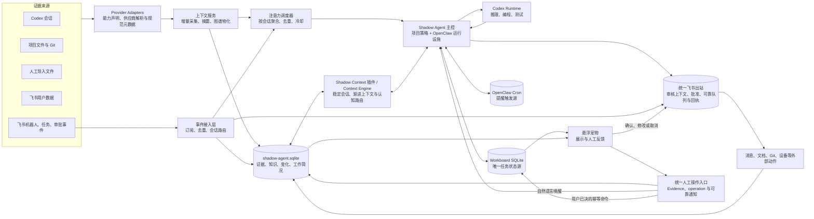
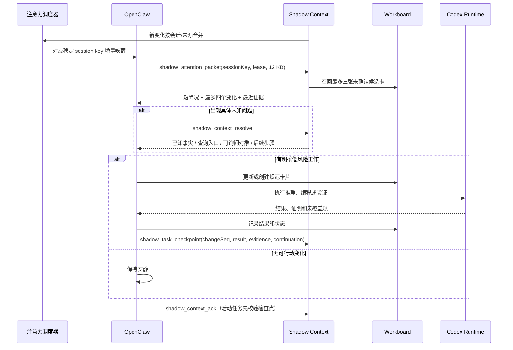

# Shadow Agent 当前架构

| 项目 | 内容 |
|---|---|
| 文档状态 | 现行实现说明 |
| 实现基线 | Shadow Agent V4.27.0 源码，含长期委托和原生能力扩展；不等于正式后台已部署 |
| 最后核对 | 2026-10-20，业务策略与执行边界见 ADR-0038；部署证据与源码分开记录 |
| 规范依据 | [项目契约](PROJECT_CONTRACT.md) |

本文件描述当前代码和运行时如何实现项目契约。它不是第二份产品契约；发生冲突时以 `PROJECT_CONTRACT.md` 为准。

### 2026-10-23 同源信息与运行中任务

`information-delivery.mjs` 在既有 context_changes 上保存来源页的显式分发决定及各接收方回执，知识维护与任务会话独立消费同一 Evidence 引用。任务仍只提交候选；`epistemic.js` 比较原始支持与复核版本，复用已表达事实或反馈实质修订，Workboard 仍由原任务控制会话维护。

`active-information.mjs` 通过插件 after-tool 钩子查询当前稳定会话的新事件、有界返回提示，用公开 SDK 提示原活动运行读取队列；不是新的调度线程或模型，不保证大积压下查询工作为常数。提示不含原文、不授予权限，队列接受不是采用证明，离线仍由原调度恢复。原运行实际采用、任务检查点和接收方 ACK 分别留证；子执行器联动尚待单独验证。契约和结果见 [ADR-0043](decisions/0043-information-fanout-and-active-task-updates.md)与报告，未安装到正式后台。

### 2026-10-23 仓库与文档入口维护

`knowledge-entries.mjs` 从现有证据生成可重建的导航表示。仓库分别选取快照与有效历史，文档目录只作集合；其已选文件以来源 ID/完整路径拥有独立 Document 入口及当前版本的全部块指针。高优先级简介不变，核心和插件通过共享纯函数将派生线索加入实体 FTS。历史扫描中未被目录选择的日志/数据文件不批量升为图谱实体，仍可检索原 Evidence。

日常物化与显式修复使用相同选择/写入代码，不新增主控、语义状态或全库高频任务。来源索引让局部更新限定在对应仓库/项目；补建的是导航，不是业务事实。修复授权、测试及正式数据状态见 [ADR-0044](decisions/0044-derived-knowledge-entry-maintenance.md)和验证报告。

### 2026-10-22 知识一致性修复

维护插件 `epistemic.proposeKnowledge` 适配参数后调用 `src/graph-model.mjs`，不再独立维护事实、证据评估、冲突和取代写入。`currentFactTrust` 共用纯规则 `knowledge-policy`，供查询与个人简况按指定时间派生可信结果；查询不回写缓存。插件安装脚本部署同版共享模块，隔离加载测试覆盖其依赖。

`shadow_context_query/resolve` 提供 `asOf/scopeKey`，保留有效历史区间和明确来源；未来交接不能使当前前任提前消失。`USER.md` 仍是同一图谱的投影，不增加第二份个人知识。定点恢复函数只处理内容未变且已有明确资料评估的机械回填，忽略已被其他复核流程占用的来源。

`taskConversationPage` 默认返回进展投影及原事件身份，renderer 使用共用 `task-progress-presentation` 完成跨页合并与刷新。复查聚合复用真实 writer 已有检查点，不增加写入协议；仅接受连续且实质字段相同的 `unchanged`，未知格式保留。`view="audit"` 按同任务精确 seq 返回原件，界面支持展开、失败重试；不删除审计或改变 Workboard 状态。四卡真实历史样本 49 条展示缩为 41 条，其中连续 9 次复查折叠为 1 条，人工输入与真实变化保留。该结果不代表全库比例或检索降噪已完成。详见实现验证与限制。本次未安装生产插件、迁移正式库或重启后台。

### V4.27 新架构落点

- 长期目标继续使用现有 Workboard 卡片。`task-progress-plan.mjs` 校验有版本的行动方案；`shadow_task_checkpoint` 在同一事务保存方案、执行判断和可选知识差量。`shadow_context_focus(taskId)` 精确读取完整方案，注意力包只携带当前任务的简版，不增加全库上下文。方案不具有授权或生命周期权威。
- 检查点的 `learning` 需要原始 Evidence、关键词及检索问题，复用 `captureResolutionKnowledgeDelta` 和专用维护会话。原子回滚和幂等防止“结果保存了但学习丢失”；既有人工反馈、冲突、取代与证据可信度不变。
- `openclaw/runtime-profile.mjs` 显式分离 controller/codingWorker，按模型引用选择原生 runtime。供应商、鉴权、MCP 和额外技能保留；当前默认仍是 Codex，不代表已经开通 DeepSeek 账号。
- `manage-mcp-capability.mjs` 复用原生 MCP probe，提供候选哈希、过期检查、显式发布和逐项撤回。默认禁用；明确授权才加入精确工具表。发布回执明确不等于运行时可见或业务成功，详见 [操作说明](operations/capability-growth.md)。
- 工作区增加按需读取的 `task-progression`、`capability-growth` Skill；Workshop 是可选工具，不是已授权本地技能开发的必经环节，不启用第二个后台整理主控。

### 项目策略与任务隔离

按 [ADR-0038](decisions/0038-owned-policy-and-task-boundaries.md)，`openclaw/shadow-policy` 在主提示入口提供项目身份和分角色规则。主控完整规则维护在仓库模板；活动工作区 AGENTS 只留简短入口，避免 Codex 后续 bootstrap 重复注入。偏好独立保存。Codex/API 两条路径在 hook 后校验策略，失败保留事件而不是使用默认人格。该插件不是新的模型或主控。

`visibility=agent` 只扩展同 Agent 会话读取能力。任务工具按可信 runtime session 与原卡绑定校验；工程子会话返回证据，不决定任务生命周期。`shadow_context_focus(taskId)` 的精确任务结果提供 `checkpointRevision/bindingRevision/ownerSessionKey/execution`，checkpoint/outbox 复核版本与执行身份。迟到结果可保存证据，但不覆盖新进展；绑定执行不自动将业务卡改成 running。Workboard 存储及现有稳定会话 ID 保留。

边界：已有巡检、任务会话、子任务回执和人类反馈链路继续承担调度与执行。该版本没有另建模型规划服务，也没有证明任意第三方软件能无人干预接入。实际自主决策质量、跨天推进效果和真实第三方写入仍需要独立实测。

任务分级推理由 `src/openclaw/reasoning-policy.mjs` 和 `config/agent.json.reasoning` 提供：消息初筛 `medium`，人工输入、任务复核及知识维护 `high`，提醒主控通知 `low`。调度基于当前到期事件类型选择，而不是解析消息关键词；等级不改变权限、归属或任务生命周期。模型及原生子任务默认值由运行配置模板维护，复杂子任务可通过原生参数显式选择 `xhigh`。

首批检索和执行恢复修复见 [ADR-0032](decisions/0032-memory-and-execution-reliability.md)。10 月 16 日恢复运行暴露的进展确认、终态重放和 UI 工具轮询问题按 [ADR-0034](decisions/0034-attention-progress-and-gateway-read-plane.md) 修复；连续跨天可靠性仍需观察，不能用单轮测试替代。

### 本轮实现边界

- 认知路由只读 `review_status/review_outcome`，不再按 metadata 中的旧状态双读；`completed` 只代表整理完成，事实仍需 `supported` 和有效支持证据才能进入 verified。预算裁剪明确报告遗漏，候选查询不声称全库召回。
- `src/openclaw/cli.mjs` 在原有 `settings` 中保存 `controller:turn:*` 运行回执，包含引用、请求哈希、观察状态及确认后的最终结果，不复制提示、历史正文或部分回复。终态结果离线可幂等返回；`native-terminal.mjs` 以精确原生结束证明补偿重启丢失的 wait 缓存。`controller:turn-active:*` 原子保存未确认运行的指针，调度不遍历历史回执。这不是任务状态源。
- 成功需原生 `ok`。人工输入和飞书对话要求最终可见回复；内部控制唤醒可接受运行时明确的 `terminalReply.disposition=silent`，不把缺失/空白回复当成静默成功。
- 提交前落回执、接受后保存实际 run ID。失联时不重发 `agent`；下一次 `agent.wait` 核对原 ID。确认失败的同一请求不自动重新执行；后续需要新决定检查副作用，而非重复发送旧请求。
- 注意力恢复不依赖原事件仍处于 pending：即使断线期间原模型已经 ACK，也从持久回执继续核对终态。未知结果保持租约；自动恢复仍受巡检开关和时间窗限制。
- Codex continuation 缺省写入 30 分钟后的观察时间。进度审计对到期执行先作有界只读 `agent.wait`；明确仍在运行则推迟复查，不调用模型、不改任务状态；终态或未知结果作为原卡复查证据。RPC 等待上限不是执行截止。
- 复查只按未过期 leased 事件计入占位，pending/过期事件保留待消费且同卡去重；保留截止日期、置顶、优先级等现有评分，同分时先选择较久未复查卡。outbox 长调用每 30 秒续租，避免被五分钟陈旧回收误抢。

自动注意力每次只观察一个运行片；pending 让出全局调度入口，但保留原运行和会话互斥。终态后再核对本批 ACK，零进展退避、新尝试才换 ID。人工交代优先于积压背景。宠物只读请求共用在途请求与短缓存，不经过工具循环检测。监督器对持续无响应复核后再重启并记录原因。

保留限制：outbox 批内仍串行，原生模型并发由运行时控制；无可靠运行存在性证明时保留待核对，不自动重执行。仅对明确已丢失且不在原生持久队列/worker 中的 attention 运行，发出业务结果未知的同会话核对事件，不能重放原动作。模型工具协议合并、责任语义回放和跨天验收仍在后续阶段。

10 月 17 日按 [ADR-0035](decisions/0035-intake-and-review-recovery.md) 补齐摄入和条件恢复：个人采集使用业务读取结果报告健康；消息固定窗口逐页续采，末页才更新覆盖游标；全量与快速采集对同库串行。条件 action 携带 watch/generation，终答成功但未形成条件判断不能完成投递；历史待判断失败继续使用原 outbox 有界恢复。该次变更只新增只读存在性字段的受控底座补丁；不是当前所有底座补丁的数量。10 月 20 日策略输入校验另见 ADR-0038，两者均不增加调度主控。

## 1. 系统边界

Shadow Agent 当前由三个长期运行组件、一个事件接入层和三个持久数据面组成。事件接入层运行在上下文服务进程内，不是第二主控：



组件责任严格分离：

| 组件 | 负责 | 不负责 |
|---|---|---|
| Provider Adapter | 供应商认证/读取能力声明、事件解析、规范来源与消息/执行元数据 | 判断任务归属、创建 Workboard 卡、写长期事实 |
| 上下文服务 | 采集、游标、去重、确定性摘要、图谱物化、变化生成 | 选择任务、执行外部动作 |
| 事件接入层 | 长连接订阅、快速轮询、事件回执、稳定会话路由、出站模式门 | 规划回复、创建第二任务队列、旁路发送 |
| Shadow Context 插件 | 稳定会话引导、变化租约、认知路由、局部检索、知识维护、创建待确认草稿 | Workboard 状态、通用调度、批准或发送消息 |
| OpenClaw | 唤醒、选择注意力、授权判断、调度、任务推进、通知 | 保存第二份任务库 |
| Codex Runtime | 复杂推理、代码和文档修改、测试与工程验证 | 独立长期规划与任务状态 |
| Workboard | 任务、状态、执行关联、证明和历史 | 原始证据与通用知识 |
| 宠物 | 可视化、详情、人工确认和补充、出站草稿修改/确认/取消 | 独立业务状态、直接发送和后台调度 |
| 统一人工操作入口 | 先保存 Evidence、因果操作和幂等副作用，再通知归属会话；落实用户已明确作出的结构化决定 | 解释任意自然语言、建立第二任务状态机 |

## 2. 目录映射

| 路径 | 作用 |
|---|---|
| `src/collectors/` | Codex、项目、导入资料和飞书采集器 |
| `src/source-adapters/` | Provider 能力契约、注册表以及 Codex/飞书供应商解析 |
| `src/source-records.mjs` | Observation、Collaboration、Execution 正式规范表、一次性迁移和查询接口 |
| `docs/SOURCE_ADAPTER_ARCHITECTURE.md` | 多源适配器能力、Collaboration/Execution 领域投影和当前 Codex/飞书映射 |
| `src/db.mjs` | 来源、证据、摘要队列以及兼容历史表的模式和访问层 |
| `src/context-graph.mjs` | 增量图谱物化、变化队列、工作简况表 |
| `src/attention-scheduler.mjs` | 飞书会话分组、不同来源冷却时间和持久注意力合并规则 |
| `src/work-sessions.mjs` | conversation/task/inbox/knowledge-curation 稳定会话分流、会话级租约与运行态；task 按卡片独立，项目仅保留候选作用域 |
| `src/cognitive-profile.mjs` | 人工维护职责、知识入口、源码位置和责任人关系的结构化导入 |
| `src/user-profile-view.mjs` | 本人事实索引查询、可信派生、统一简况与有界模型投影；供应用及安装插件复用 |
| `src/user-profile.mjs` | 冷启动确认、既有本人迁移、初始化任务入队及 USER.md 修订回收；没有独立个人事实库 |
| `src/team-profile.mjs` | 将受控团队档案确定性转换为通用认知实体和关系，不执行模型推理 |
| `src/graph-model.mjs` | 开放词汇、证据画像、推导、冲突和知识单元维护 |
| `src/graph-maintenance.mjs` | 旧知识迁移质量与事实失效传播 |
| `src/daemon.mjs` | 单实例上下文服务及增量/低频全面采集调度 |
| `src/realtime/` | 飞书事件消费、快速轮询、OpenClaw 唤醒与连续会话桥接 |
| `src/reminders.mjs` | 提醒投影、OpenClaw Cron 调度和到期交付 |
| `src/condition-watches.mjs` | 增量条件候选筛选、证据游标与超时兜底 |
| `src/controller-outbox.mjs` | 模型意图的持久化执行、崩溃恢复与退避重试 |
| `src/outbound-messages.mjs` | 经批准飞书消息的身份保持、幂等发送、回执证据与回复跟踪 |
| `openclaw/shadow-work/` | OpenClaw Context Engine、认知路由工具与契约清单 |
| `runtime/openclaw-poc/workspace/` | 当前已部署的 Shadow Agent 身份和 Heartbeat 规则 |
| `desktop/` | 宠物界面、Workboard 读取和人工反馈桥接 |
| `scripts/` | 安装、启停、迁移、验证和审计工具 |
| `config/agent.json` | 可共享的采集和图谱默认参数 |
| `config/agent.local.json` | 可选的本机覆盖，不应进入交接材料 |
| `config/policy.json` | 权限类别声明与采集阻止路径 |
| `docs/knowledge/source/` | 可审计团队认知原文，仅在局部证据展开时读取 |
| `docs/knowledge/structured/` | 通用 `cognitive-profile` 导入快照，不是第二套知识库 |
| `runtime/shadow-agent.sqlite` | 本机证据与知识数据库 |
| `runtime/openclaw-poc/state/` | OpenClaw 私有运行状态、授权和 Workboard 数据 |

`scripts/apply-openclaw-runtime-profile.mjs` 是项目目录迁移后的规范路径重绑定入口。它从当前源码根目录一次性更新 OpenClaw 工作区、Shadow 主数据库、Workboard 数据库、Codex Supervisor 和原生 Codex runtime，运行配置不得保留旧项目根目录作为隐式依赖。

`runtime/` 是运行状态，不是可共享配置模板，也不得在文档中复制其中的令牌或个人授权信息。

## 3. 上下文数据面

### 3.1 基础证据模式

`src/db.mjs` 管理以下基础数据：

- `sources`：来源、URI、状态、游标和错误。
- `projects`：从 Codex 状态发现的项目根目录。
- `threads`：Codex 会话元数据和 rollout 定位。
- `artifacts`：项目文件、仓库和外部对象的当前元数据。
- `evidence`：原始事件、正文片段、工具轨迹摘要和派生摘要。
- `evidence_links`：摘要、取代等证据间关系。
- `digest_queue`：受影响会话、仓库或文档集合的增量摘要队列。
- `settings`：各采集和物化游标、运行状态与迁移标识。
- `external_event_receipts`：外部事件去重、重试和业务副作用状态。
- `conversation_bindings`：外部会话、项目工作流和 inbox 到稳定 OpenClaw 会话键、代际与上下文 epoch 的映射。
- `reminders`：提醒来源、到期、Cron 绑定、交付和人工确认投影。
- `condition_watches`：持续条件、筛选器、证据游标、会话绑定、候选和超时状态。
- `outbound_message_drafts`：收件人、发送身份、原会话、正文修订、批准模式、有界审核上下文、状态、回执和审计。
- `controller_outbox`：提醒调度、条件唤醒与飞书发送的幂等可靠执行队列。
- `source_observations`：来源、账号范围、稳定对象、事件、流、因果和回源定位的规范记录。
- `collaboration_events`：人员、空间、会话、回复、方向和协作资源的规范记录。
- `execution_events`：执行会话、工作区、版本、工具、模型和状态的规范记录。

旧 `knowledge_candidates`、`tasks`、`patrol_runs`、`action_log` 仍保留用于历史读取和迁移兼容。它们不是当前主控接口。

### 3.2 语义图谱模式

`src/context-graph.mjs` 与 `src/graph-model.mjs` 管理：

- `graph_entities`、`graph_aliases`：开放实体和别名。
- `graph_facts`：带有效时间、认知状态和置信度的事实。
- `graph_entity_evidence`、`graph_fact_evidence`：证据回链。
- `graph_evidence_assessments`：证据方法、环境、结果、等级和立场。
- `graph_derivations`、`graph_derivation_inputs`：可展开的推导链。
- `graph_fact_conflicts`、`graph_fact_state_history`：冲突与状态迁移审计。
- `graph_episode_annotations`、`graph_enrichment_queue`：知识召回卡和语义复核队列。
- `graph_episode_fts`：知识卡的有界全文召回索引；认知路由先从索引选少量候选，零命中时只检查标题、关键词和检索提示，不扫描长正文。
- `graph_entity_types`、`graph_relation_types`：开放词汇与建议传播权重。
- `context_changes`：交给唯一主控处理的增量变化流。
- `user_profile_binding`：安装级本人实体指针；工作简况与私有 `USER.md` 读时从通用图谱生成，无独立职责正文表。

用户知识、冷启动和简况统一规则见 [ADR-0040](decisions/0040-user-knowledge-projection-and-onboarding.md)。投影只查询本人相邻事实及其证据，不扫描全部历史；模板与配置不维护个人认知。冷启动使用已有结构化认知导入，文件修改使用已有人工知识复核队列。
- `work_task_attention`：任务截止时间和关注覆盖层。

数据库模式初始化是幂等的。图谱当前契约版本由代码常量和 `doctor` 检查共同确认，不以文档标题推断。

团队人员、部门、角色、职责、项目、协作与求助入口也使用同一套开放实体和 Fact。`team-cognitive-profile.v1.json` 只是从受控原文生成的确定性导入边界；导入后由 `shadow_context_resolve` 和局部图查询按问题选择有限关系，原文和完整快照均不直接进入常规模型上下文。项目状态带 `asOf`、`needsRefresh` 和来源证据，不因一次导入永久视为当前事实。同名实体拥挤时，路由先按精确匹配、展示优先级和实体类型重排，使结构化职责优先于历史消息；OpenClaw 工具层还必须为结果渲染预留预算，最终模型可见内容不得突破调用方给定的上下文上限。

确定性团队导入器只解释已约定的 Markdown 章节格式，不宣称理解任意组织文档。本人由显式 `ownerName` 与原文成员核对，部门及共同领导关系只使用原文所列部门；未知格式或身份冲突拒绝导入。通用主策略读取版本化 `COLLABORATION.md`，个人档案和工作简况是有来源的应用数据，不是可执行主策略。旧运行目录偏好文件只归档，不自动提升为知识或指令。详见 ADR-0039。

### 3.3 Workboard 数据面

Workboard 使用 OpenClaw 插件自己的 SQLite。Shadow Context 只按只读方式读取活动卡片用于工作雷达；OpenClaw 通过 Workboard 原生工具创建、移动、评论和关联证明。

两个 SQLite 的权威边界如下：

```text
shadow-agent.sqlite  -> 发生过什么、知道什么、依据是什么、什么发生了变化
Workboard SQLite     -> 现在要做什么、做到哪一步、由谁执行、完成证据是什么
```

不得通过数据库复制把两者合并成两个都可写的任务状态源。

### 3.4 多源适配与规范存储

`sources`、`threads` 和 `evidence` 保存来源、执行会话定位与唯一原始正文。`src/source-records.mjs` 管理正式的 `source_observations`、`collaboration_events`、`execution_events`；Provider Adapter 在 Evidence 写入事务中直接生成规范记录，统一来源、事件身份、时间、游标、权限、因果和回源定位。领域表只引用 Evidence，不复制正文，也不把所有来源解释成同一种消息。

中间语义保持两个领域：

- Collaboration：飞书等企业协作来源的 Communication、Content、Work、Organization。`src/source-adapters/providers/feishu.mjs` 统一轮询与实时消息元数据；`src/collectors/feishu.mjs`、`src/realtime/feishu-events.mjs` 和既有可靠链路继续负责 API、回执、有界激活与 HITL 出站。
- Execution：Codex 等编程 Agent 来源的 Session、Run、Turn、Tool、Artifact、Status。`src/source-adapters/providers/codex.mjs` 把 rollout 对象转换为规范 Evidence；`src/collectors/codex.mjs` 只负责 `state_5.sqlite`/JSONL 发现、快照游标和短事务，`src/digests.mjs` 维护一代可检索会话摘要。

两个领域只在 Task、Decision、Commitment、Artifact、Person、Project、Knowledge 和 Evidence 关系上汇合。`shadow_evidence_search` 按领域、供应商和规范事件选择一级证据，`shadow_conversation_window` 使用 `provider + streamId` 读取精确 Collaboration 窗口。V4.23 已一次性回填现有 Codex/飞书记录并删除旧视图和旧查询 API；未注册来源不会按 Evidence 名称被猜成某个供应商。完整字段、能力降级和准入顺序见 [多源适配与领域汇合架构](SOURCE_ADAPTER_ARCHITECTURE.md)、[ADR-0028](decisions/0028-source-domain-adapters.md) 与 [ADR-0029](decisions/0029-canonical-source-storage-cutover.md)。

## 4. 采集与物化流程

### 4.1 启动

`src/daemon.mjs` 使用 `runtime/context-service.lock.json` 防止上下文服务重复运行。启动后先执行一次轻量增量采集，再启动飞书事件桥并恢复失败回执，避免两个启动写入在同一 SQLite 连接上重叠；首次事件恢复失败只记录并交给已安装的恢复定时器。若距离上次全面项目核对超过配置间隔，再把全面采集串行排入队列。

### 4.2 本地增量采集

默认增量周期来自 `config/agent.json`，当前为 15 分钟。增量轮次：

1. Codex rollout 根据每个文件的字节游标读取新增行。
2. 导入目录根据路径、时间和内容指纹读取新增文件。
3. 飞书消息由独立快速轮询读取；本地轮次不重复拉取飞书全部来源。
4. `digest_queue` 只重建受影响的会话、仓库或文档集合摘要。Codex 新用户输入和回合结束信号可立即处理；助手与工具流水按 `digestThreadQuietSeconds` 合并，避免执行中每条工具结果都重建整份摘要。
5. 图谱物化器只处理证据游标后的记录。
6. 新实体、事实或批次变化以幂等事件键写入 `context_changes`；飞书消息按会话键合并，而不是按每条消息或归属标签拆分。
7. 普通飞书消息只保留在 Evidence Log 和全文索引中；物化器维护会话入口，但不为每条消息建图节点或语义精炼任务。
8. 变化路由器把精确关联 taskId 的非知识维护事件绑定独立 task 会话，把真实飞书对话绑定 conversation，把知识复核绑定固定 knowledge-curation workstream；其余自动变化绑定隐藏 inbox，并保留项目候选键供主控判断。项目本身不创建模型会话。
9. 个人飞书轮询始终保存消息 Evidence，但在语义调度前执行结构门控：P2P、本人发言、明确提及本人、`reply_to` 指向本人消息时激活；普通群背景只在未过期的连续讨论窗口或活动任务/条件范围内唤醒。默认群连续窗口为 24 小时，背景消息不续期；被抑制的变化标为已留存证据，不能被其他无关调度重新带入模型。

轻量轮次默认跳过项目目录全面遍历。

### 4.3 低频全面核对

默认每 24 小时重新核对项目目录和 Git 元数据，用于修复 watcher 缺失、应用重启或游标遗漏。全面核对仍依赖文件元数据、内容哈希和配置上限，不把全部文件正文送给模型。

### 4.4 旧知识升级与减负

旧会话摘要、Git 摘要、人工资料和长期文档可以生成可检索召回卡，再进入 `graph_enrichment_queue`。原始飞书消息不再逐条进入语义精炼队列；V4 迁移移除其未完成队列和会话到单条消息的图链接，但保留原始 Evidence 和已确认的稳定事实。OpenClaw 只有在没有更重要工作时才领取有限知识单元复核。

OpenClaw 插件在 Gateway 生命周期内复用只读和写入 SQLite 连接。工具调用仍保持独立事务，但不会为每次渐进式查询重新打开大型运行库；测试和迁移可显式关闭连接复用。

Codex 会话摘要采用单快照保留。一次重建完成后，同会话旧 `codex_thread_digest` 若被 `graph_fact_evidence` 或 `graph_evidence_assessments` 直接引用，则改为不可全文检索的 `codex_thread_digest_archive`；其余旧代物理删除。原始用户消息、助手消息、工具记录、rollout 和来源定位不受此清理影响。`scripts/migrate-knowledge-state-and-digests.mjs` 对历史库执行同一规则，并在写入前建立 SQLite 一致性备份。

### 4.5 统一知识差量维护

人工“记下来”、任务反馈和问题解决后的可复用结论共用一条维护链路，但保留不同证据角色：人工输入保存为 `manual_knowledge/user`，任务结果保存为 `shadow_agent_task_result/assistant`。两者都先写 `graph_episode_annotations` 和 `graph_enrichment_queue`，并生成只指向该 Evidence ID 的 `knowledge_review_due` 或 `knowledge_delta_due`。带 `knowledgeDelta.idempotencyKey` 的任务结果不再生成普通 `evidence_batch_ingested`，避免同一结论分裂成两次主控工作。

变化路由器只在事件首次未绑定时计算 `not_before`，并把这两类事件绑定到固定 `knowledge-curation` workstream；已绑定事件不会因后续调度反复推迟。原任务会话只提交幂等差量胶囊，不直接写 `graph_facts`；维护会话禁止再次调用 capture/delta/revise 生成递归 Evidence，只能领取精确 Evidence，使用其关键词、检索提示、来源 Evidence 和 locator 有界查询现有知识，然后执行以下一种结果：

1. 同义或重复：保留新 Evidence 并补充已有事实的支持，不复制平行事实。
2. 新长期知识：以来源证据提出实体和事实，再完成 Episode 标注。
3. 更新或纠正：追加修订 Evidence；只有同主体、同关系、同作用域且带来源与理由时，才用 `supersedesFactId` 关闭旧事实有效期。校验失败时保留新旧事实并进入复核。
4. 一次性信息：复核状态写 `completed`，结果写 `no_durable_facts`。
5. 已建立长期事实：复核状态写 `completed`，结果写 `facts_recorded`；这不自动提高事实可信度。
6. 职责、身份、偏好、权限、承诺或冲突证据不足：复核状态写 `needs_input`，等待人工确认。

人工输入携带的 `project`、`projectKey`、`repository`、`component`、`topic`、版本和环境等作用域，在捕获、修订、图谱证据评估和最终 Annotation 中复用同一受控 schema。最终维护调用即使省略 scope，执行层也继承 Episode 原作用域、salience 和已有元数据，不能用空对象覆盖。事实提案以 `sourceEvidenceIds` 绑定精确原始 Evidence，并用规范化 `method` 计算证据等级；更细的说明进入 notes，避免自由文本方法名把源码证据错误降为零级。

该 workstream 是唯一 OpenClaw 身份下的上下文边界，不是第二主控或第二知识库。处理结束后仍通过 `shadow_context_ack` 关闭精确变化。

知识状态由 `src/knowledge-policy.mjs` 统一定义，主上下文服务和 OpenClaw 插件共用同一实现。Episode 处理状态、处理结果、Fact 生命周期、Evidence 立场和 Fact 可信状态分别存储；业务谓词仍允许 learned 扩展。`mentions` 只建立 Entity-Evidence 链接，不进入事实证据评价。事实可信状态由未失效评价和开放冲突集中计算，维护扫描只在 `metadata.graphMaintenance` 标记复核原因，不再写入第五种 `needs_review` 可信状态。

## 5. 事件驱动注意力流程

OpenClaw 周期 Heartbeat 默认关闭。采集负责产生变化，注意力调度器负责按来源合并、冷却和恢复，只有确有待处理变化时才唤醒 OpenClaw 判断是否行动。这样保留主动性，同时让空闲状态不产生模型轮次。



`shadow_task_checkpoint` 是任务关注覆盖层中的结果核验回执，不是第二套任务状态。它只绑定精确 Workboard 卡和已租赁变化，记录本轮看到了什么、证据是什么、下一次由哪个可观察事件继续。任务状态、验收和关闭仍只由 Workboard 表达；审计器预写的复查时间不能满足确认门禁。

工作雷达由插件在本地对活动 Workboard 卡片排序。明确 DDL、人工置顶、阻塞、业务影响、优先级、长期职责命中和近期更新共同形成解释性评分。评分只控制本轮注意力，不修改任务状态。飞书消息中的归属标签也只控制冷却时长，不直接决定任务归属。

没有明确 DDL 的卡片保持空值；排序理由会返回给模型和验证工具，便于发现错误归因。

### 5.1 实时与快速触发

上下文服务同时维护以下入口：

- **个人工作主来源**：以 `user` 身份读取本人可见消息、文档、任务和审批。消息每 60 秒增量读取并完整留存；同一聊天/话题的变化合成一个包。单聊与明确提及默认 45 秒内调度，本人发言 90 秒，普通群聊 5 分钟，纯机器人会话 10 分钟，最长等待 10 分钟。标签只调节时效，Agent 结合完整会话判断归属。
- **文档变化**：最近文档每 10 分钟有界检查。目录项按文档身份去重，`edit_time` 只用于决定是否重新读取正文；只有正文哈希变化才进入语义队列。Base 等结构化数据不把容器编辑时间当正文变化，后续由记录事件或专用表游标接入。
- **个人实时加速器**：任务和审批事件使用 `user` 身份长连接。后台订阅未批准时标记为 `waiting_external_approval`，停止无意义重连，但不影响上述个人 API 主链路。
- **API 补偿**：任务和审批各自按 15 分钟配置进行有界增量拉取，不再只依赖每日全面采集。
- **机器人对话入口**：只有发给 Shadow Agent 机器人的单聊或群聊明确提及使用 `bot` 身份实时接收，并按外部会话键进入同一个串行 OpenClaw 会话生成回复正文。当前 `hitl` 模式生成待确认草稿；未来显式 `automatic` 模式自动批准同一出站记录。它不代表用户收件箱，也不依赖通用巡检偶然生成回复。
- **全面补偿**：本地增量采集、10 分钟注意力恢复检查和 24 小时全面核对覆盖丢失事件、临时断网和游标修复；恢复检查只在存在未消费变化时唤醒模型。
- **Codex 会话证据**：用户消息、助手结果和工具痕迹都持续增量保存；只有新增用户输入改变会话摘要时才进入注意力队列，助手执行日志本身不会再触发 Agent。

实时入口不自行判断任务。OpenClaw 在会话变化包中决定它是背景、关注、候选任务、已有任务延续还是本人任务，并记录判断依据。内部 Workboard 分类可撤销；业务重要性、紧迫性和技术相关性、提及对象都只是证据，不能单独代替整体判断。回复和其他外部动作继续经过授权门。

普通机器人群消息若没有明确提及机器人，只保存 Evidence 和 `ignored/background_ignored` 回执，不直接物化语义变化、不调用模型。可处理机器人对话、自动注意力和人工输入共享 `SessionDispatchQueue`，同一 `session_key` 串行，不同会话可以并行。任务和审批事件只通知统一注意力调度器，不再从旁路直接唤醒 OpenClaw。

`external_event_receipts` 保存处理租约、下次重试时间和重试载荷。失败使用指数退避；服务重启后会回收过期 `processing` 并继续处理。回复先形成稳定幂等的 `outbound_message_drafts`，实际发送由 `controller_outbox` 恢复和重试，避免网络回执丢失造成重复发送。

### 5.2 统一飞书消息出站

飞书回复和主动消息只有一条持久链路：

```text
外部消息/主控意图 -> 对应稳定 OpenClaw 会话生成正文 -> outbound_message_drafts
  -> hitl: 宠物修改、确认或取消
  -> automatic: 代码按显式模式自动批准
  -> controller_outbox -> lark-cli 发送 -> 回执 Evidence -> 会话/条件跟踪
```

`config/agent.json` 的 `feishu.outboundMessages.mode` 只有 `hitl` 和 `automatic` 两种语义；缺失或非法值一律降级为 `hitl`。当前部署使用 `hitl`，不按联系人设置黑名单或白名单。模式只决定批准方式，不选择另一套发送实现。

实时消息提示只要求 OpenClaw 返回回复正文；事件桥以 `reply_to_message_id + approval_mode` 复用或创建唯一活动草稿。草稿成功不确认同一 Evidence 对应的通用 `context_changes`，来源仍待审并单独调度，按 ADR-0043 保存分发决定后再消费。草稿幂等与来源知识/任务审查是不同责任。事件桥在生成前固定一份审核快照：当前触发消息单独保存，最近对话按时间合并且最多八条，生成依据、Evidence ID、session key 和来源定位随草稿保存；审核页面不需要在打开时重新扫描历史。主动询问和非事件工作仍由 OpenClaw 使用 `shadow_outbound_draft_create`，并必须提供面向审核人的 `contextSummary`。

出站身份由 `feishu.outboundMessages.senderIdentity` 配置并随草稿持久化。当前为 `user`：机器人单聊入口经 HITL 后改为向对方发送用户私聊，群聊明确提及仍回复用户可见的原群；不能用用户令牌回复用户并不参与的机器人单聊。宠物按“触发消息、最近对话、生成依据、拟发送正文”展示审核材料；渲染进程只提交批准或拒绝，不直接调用飞书。只有发送身份显式为 `bot` 时，`automatic` 才能启用；用户身份始终降级为 `hitl`。

### 5.3 稳定会话与渐进上下文

OpenClaw 使用原生 Codex harness。人工入口复用 `agent:main:shadow:user`，相同 `provider + chat + thread/root` 复用 conversation session，后台变化复用隐藏 inbox；不同真实对话隔离。项目是图谱和检索作用域，不建立默认永久模型会话。Shadow Context Engine 的 `thread_bootstrap` 只投影不随数据库变化的控制协议；职责、待办、跟踪、候选关系和项目事实由当前轮有界工具按需提供。`contextInjection=continuation-skip` 使安全续轮不重复注入工作区文件。

Context Engine 不另存模型聊天历史，也不拥有压缩算法。它把 compaction 委托给 OpenClaw runtime；当前版本使用 `safeguard + midTurnPrecheck + maxActiveTranscriptBytes` 负责语义摘要与活动 transcript 保护。主控工具策略为 `minimal + 显式允许`。当前原生 Codex runtime 使用 `codexDynamicToolsLoading: direct`：2026-08-31 全新会话 A/B 中，`searchable` 虽降低成功轮时延，却只有 2/6 目标工具完成，不能满足生产可靠性。模型和思考等级是可变运行参数，必须从实时配置读取。

控制轮的运行截止与本地观察窗口分离。生产 Gateway run 使用 `runTimeoutSeconds: 0`，不以累计墙钟时间判断失败；本地每 60 秒调用一次 `agent.wait`。`pending`，以及没有 `endedAt` 且阶段为 `queue/gateway_draining` 的 `timeout`，都只是观察窗口到期，必须续等且不改变任务、变化或回执状态。只有带运行结束时间的 `ok/error/timeout` 才是终态；无模型流量和重复无进展由 runtime 的 idle watchdog 与 loop detection 处理。长编程执行使用独立 child session 和完成事件，不在主控轮内同步占用数小时。

主控派发 Codex 子任务时使用独立的有界执行简报：目标、验收标准、授权范围、当前差异、必要约束和证据定位合计不超过 8 KiB。`allowRawTranscripts` 只允许按任务读取本机 Codex 结果，不会自动把 transcript 注入新任务；完整 OpenClaw 会话、Workboard、图谱或外部聊天不得作为 Codex 输入附件。续轮只传递未满足的验收差异，避免重复搬运旧上下文。

### 5.4 认知路由与外部求助

Codex Supervisor 读取历史有独立的输出投影边界：`src/openclaw/bounded-codex-session.mjs` 在原生 `codex_session_read` 返回前按轮次/项分页，限制字符串与总字节，然后仍走原生脱敏。原始 transcript 和 runtime compaction 不变。`scripts/apply-codex-session-read-boundary.mjs` 对已安装原生插件作幂等、锚点校验的窄修补；Gateway 启动前校验，原生插件布局变更时必须重新验证，不静默套用未知版本。该边界解决同步脱敏拖死本地 Gateway 的实测问题，不是第二套会话存储或摘要系统。

Shadow 插件的同步 SQLite 工具和 `commitTurn` 通过 `database-worker-client.js` 派发到一个串行工作线程。主线程只注册原有工具并等待结果，schema、权限检查、返回格式与主控职责不变；长查询、锁等待和提交不再阻塞 Gateway HTTP/WebSocket 心跳。线程退出会拒绝未确认请求，下一请求可建立新线程，但不自动重放旧写操作。底层查询性能与原生 OpenClaw 内部 SQLite 仍需单独观测，工作线程不是性能问题已经消失的证明。

通用图谱保存 `DOCUMENTED_IN`、`IMPLEMENTED_IN`、`QUERY_VIA`、`RESPONSIBLE_FOR`、`EXPERT_IN`、`CONTACT_VIA` 等路标。`shadow_context_resolve` 分开返回 `verifiedFacts`、`reviewPending`、`conflicts`、检索路标、可询问人员和仍未知但有下一步；过期、反驳、争议或仅有失效证据支持的材料不进入已验证事实。它不直接发送飞书消息；OpenClaw 用 `shadow_outbound_draft_create` 建立待确认消息，批准后的可靠发送会自动留下证据并按需建立 condition watch。

人工职责、同事关系和知识入口通过 `config/cognitive-profile.local.json` 导入。共享示例不含个人 open_id 或内部链接；每次导入先保存人工 Evidence，再以 E1 证据支持关系，避免产生无来源的“负责人”事实。

### 5.5 提醒链路

用户可见提醒由 `shadow_reminder_create` 先登记 `reminders` 投影和 `controller_outbox` 意图。上下文服务可靠领取该意图，再创建带版本声明键的 OpenClaw Cron 作业。到期状态依次为 `scheduled → notification_pending → delivered → acknowledged`；只有主控唤醒成功后才进入 `delivered`。失败保持 `notification_pending` 并由 outbox 重试。`shadow_reminder_update` 和 `shadow_reminder_cancel` 递增修订号、废止旧动作并可靠清理旧 Cron。宠物支持确认、自定义延后、修改和取消。

Agent 内部任务复查不经过该链路。`task-progress-supervisor` 把下一次内部检查写入 `work_task_attention.next_review_at`，到期后只产生一条有界 `task_progress_due`。插件拒绝缺少行动主体、来源依据及来源证据的推导提醒；绑定任务的提醒按 `task_id + due_at` 生成规范幂等键，模型改变标题或自定义键不能重复创建。

### 5.6 条件跟踪链路

OpenClaw 使用 `shadow_condition_watch` 保存“等待某个回复、状态或结果”的自然语言目标和窄筛选器。跟踪创建时记录当前证据行号；实时事件、快速采集后立即检查，30 秒定时器只作漏检补偿。筛选命中只把状态改为 `candidate` 并通过 `controller_outbox` 唤醒该条件所属的稳定会话，OpenClaw 再用 `shadow_condition_resolve` 作语义判断。

超时时间是持久化兜底检查点，不是任务截止状态。服务重启后仍能发现已到时间的跟踪；继续等待时必须设置新的超时或清除旧超时。条件满足不会自动把 Workboard 卡片移到 `done`，仍按任务证据与人工确认规则处理。

宠物快照对 `active`、`candidate`、`timed_out` 跟踪做有界只读投影，并批量解析来源证据和候选证据。`candidate` 只表示采集器发现疑似匹配，`timed_out` 表示等待条件到期，两者都由唯一主控复核，不是用户待办。状态条打开后展示自然语言条件、最近检查和超时时间、稳定会话、关联任务、错误与证据正文；渲染层不调用 `shadow_condition_resolve`，因此查看详情不会推进游标、改变状态或创建 Workboard 卡片。

### 5.7 统一人工反馈知识 Episode

`openclaw/shadow-work/src/epistemic.js` 的 `captureKnowledgeEpisode` 是人工反馈的统一知识入口。它在原有 `captureKnowledge` 之上生成最低限度的摘要、关键词、召回提示、范围和 `humanFeedback` 元数据，随后仍写入同一 `evidence`、`graph_episode_annotations`、`graph_episode_fts` 与 `graph_enrichment_queue`。`shadow_context_capture` 是它的 OpenClaw 工具适配层，宠物统一入口中的知识交代、任务反馈和飞书审核直接调用同一函数；系统没有新增人工反馈表、偏好库或专用学习进程。

宠物适配器只负责构造有界 Episode：任务反馈包含卡片标题、当前状态、说明和用户原话；消息修改包含审核上下文、原始草稿和批准稿；消息拒绝包含审核上下文、被拒绝草稿和用户必填原因。原始正文经统一秘密脱敏后保存，幂等键由动作、目标和正文指纹生成。后台仍由现有 enrichment 租约小批量交给 Codex，按开放词汇图谱判断一次性指令、作用域偏好、职责、职责边界、纠正或无长期事实。

知识 Episode 不拥有业务状态。任务评论、证明与移动仍通过 OpenClaw Gateway 写 Workboard；消息批准或拒绝仍由 `outbound_message_drafts` 和 `controller_outbox` 管理。宠物在图谱尚未初始化时只执行一次无结构扫描、无维护任务的幂等初始化，使人工反馈入口可用而不触发全库重建。

V4.5 把原始 Episode、`operation_id`、`causation_id`、目标卡、基础状态、期望效果和控制会话放进同一 Shadow SQLite 事务，再由 `controller_outbox` 幂等写入 Workboard 并唤醒 OpenClaw。卡片内自然语言消息只追加带操作标识的 Agent 跟进评论，不由宠物改变卡片状态；结构化“确认完成/批准/拒绝”可以立即执行，但同样产生 Agent 变化事件。跨数据库副作用失败时保留 pending/retry，恢复后按操作标识续送。

宠物任务详情通过 `source_locator` 有界查询当前 Workboard 卡关联的 Episode。在“跟进记录”中显示原始反馈已收录、排队、语义复核、图关系结果或失败重试，在“来源证据”中展示对应原始 Evidence。该投影只提供可观测性，不领取 enrichment 租约，也不建立第二套知识处理链。

### 5.8 统一人工入口的可靠投递

首页自然语言输入不再让 Electron 等待一轮模型执行。主进程在同一个 Shadow SQLite 事务中写入 `manual_knowledge` Evidence、唯一 `direct_input_receipts` 回执和 `process_direct_input` 类型的 `controller_outbox` 动作，提交后立即返回“已可靠接收”。回执只投影 `queued / processing / retry / completed / failed`、模型回复和关联卡，不判断消息是问题、知识、提醒还是任务，也不复制 Workboard 生命周期。

上下文服务领取动作后，通过 session dispatcher 串行进入固定 `agent:main:shadow:user` 会话。回执的 `idempotency_key` 同时作为 Gateway run identity，首次 `started_at` 作为重试读取回复的稳定历史下界；短时离线、等待超时或进程重启不会换 run identity。模型正文已经写入会话但 `agent.wait` 失败时，执行器仍读取并接受该轮新增回复；后续卡片查询失败则保持回执为 `retry`，恢复后继续同一个动作。

处理完成后执行器按 Evidence ID 查找本次创建或续接的卡，为每卡绑定独立稳定任务会话、幂等投递交接事件，并把主对话回复、run ID 和卡片列表写回回执。宠物从回执分页展示连续对话，因此窗口关闭和重开后仍显示真实状态。只有回执为 `completed` 才显示“已处理”或“已进入任务卡”；`retry` 明确显示已保留并自动重试，十次退避仍失败才进入 `failed`。主对话回执完成只表示交接完成，不表示关联任务完成。

## 6. 长期工作简况

简况包含：

- `summary`：用户长期工作的一段稳定概述。
- `responsibilities`：持续职责。
- `workstreams`：活跃工作流、摘要和召回词。
- `objectives`：近期目标。
- `risks`：跨轮次需要持续关注的风险。
- `waitingOn`：等待他人、权限、设备或外部条件的事项。
- `evidenceIds`：支持这份简况的原始证据。

`shadow_context_focus` 直接生成本人事实投影；`profileNeedsRefresh` 表示基本资料缺失、迁移未完成或有覆盖缺口，`profileReviewCandidates` 只包含本人相关待整理事实/冲突。`shadow_context_focus_update` 只能选择已有 Fact 的展示类别，不能写另一份简况正文。普通日志不改变投影，事实或有效证据变化会改变内容指纹。详见 [用户知识与冷启动](operations/user-knowledge-onboarding.md)。

## 7. 任务与人工反馈

宠物通过 OpenClaw Gateway 读取 Workboard，而不是读取旧 `tasks` 表。它将卡片分为：

- `running`：正在做。
- `review`、需要人工处理的 `blocked`：需要用户确认或授权。
- `ready`、`todo`：Agent 待处理。
- `done`：刚完成和历史。
- `backlog`：历史线索，默认不计入当前待处理。

“确认已完成”会给当前卡片增加人工证明并移动到 `done`。卡片内继续交代默认更新当前目标；只有明确独立时才创建关联卡片。所有操作必须保留 Workboard 事件和证明，不只修改 UI 文案。

“继续交代”是卡片内单一的自然语言任务处置入口，可表达新要求、问题、纠正或停止。宠物只保存 Episode 和任务消息事件，OpenClaw 在卡片控制会话中决定回答、更新、关闭、拆分或询问；用户一次表达清楚时不再增加第二次确认。宠物源码不再以“不属于职责、停止跟进、取消任务”等正则直接改变任务状态。

宠物主进程持有唯一系统托盘角标。窗口右上角 `X` 和原生窗口关闭事件都只调用 `hide()`；托盘单击、托盘“显示工作现场”和第二实例启动事件调用同一个恢复函数。托盘“退出 Shadow Agent”调用 `stop-shadow-agent.ps1`：先阻止 Gateway 监督器重启，写入上下文关闭请求使服务清理消费者、定时器和 SQLite，再停止两个后台计划任务，并按当前项目路径和固定入口识别超时残留的上下文服务、Gateway 及其子进程树。只有脚本确认后台归零后，Electron 才设置退出状态并结束；失败时保留宠物、恢复菜单并写入 `runtime/pet-shutdown-error.log`。窗口隐藏不改变 Workboard、提醒、出站或 OpenClaw 状态。

宠物展开为“主对话 / 工作”。主对话进入稳定的 `agent:main:shadow:user`，统一理解问题、知识、提醒和任务；聊天列表从 Evidence 和持久回执分页读取原话、最终答复及任务链接。明确任务由 OpenClaw 去重创建或续接卡并写入本次 Evidence ID，回执处理器在完成前绑定独立 task 会话、幂等投递交接事件。卡片默认打开连续任务对话，底部常驻输入框；用户操作、Workboard 评论与任务结果检查点组成只读时间线，概览/执行/证据仍可切换。主对话不承担任务长执行，不接收执行流水；普通讨论不建卡。后台 inbox、外部 conversation 和 task 的历史不互相复制。详见 ADR-0033。

受 `agentTools.alsoAllow` 白名单约束的 Shadow、Workboard、提醒和会话工具在当前生产版本直接注入首轮工具上下文，不依赖旧会话缓存，也不得让模型通过 shell 猜测工具入口。未来切换 `searchable` 必须先在全新隔离会话中覆盖明确名称和自然语言路由，证明目标工具完成率不低于 `direct`，并单独报告超时、明确不可用和误选；只证明某一个工具偶尔可搜索不足以上线。

### 7.1 稳定会话归属与短时离线

当前注意力路由把飞书真实对话映射为 conversation，会话外自动变化统一进入隐藏 inbox，并通过 `SessionDispatchQueue` 保证同一 `session_key` 串行。项目键作为候选作用域随变化保存，由 OpenClaw 在消息、会话、任务、项目、人员和职责之间建立可修订软关系。`context_changes` 的持久状态、租约与 `not_before` 可以在守护进程或网关短暂离线后重试，`controller_outbox` 对提醒和外部副作用提供相同保护。

活动 Workboard 卡的控制归属保存在 Shadow `work_task_attention.owner_session_key`，使用 `shadow-task + card_id` 生成稳定独立会话。来源会话与项目键仅保留引用，不再决定控制归属。旧卡首次操作或监督时重绑；仅路由精确 taskId 的未领取变化和关联条件，不夺取旧会话运行中的租约；旧任务租约仍有效时，新会话不得并发领取。任务相关人工操作和结果先形成带因果标识的持久变化，再唤醒该任务会话。Workboard 自身 `session_key` 仍表示原生执行或子 Agent 会话，迁移不得修改它。

`conversation_bindings` 的逻辑键保持稳定。按项目共享的历史 workstream 绑定只保留审计，不再接收新变化或新任务归属；固定 knowledge-curation 维护会话仍接收知识复核，不能把历史项目映射的禁用规则扩展到它。Shadow 不实现物理会话换代，也不拼接或重写 transcript；OpenClaw 原生 safeguard compaction 负责历史压缩、最近轮次保留和 transcript 截断。`thread_bootstrap` 使用固定投影 epoch/fingerprint，Shadow 的 `generation`、`context_epoch` 与职责修订只作诊断或工具数据，不能驱动 Codex 线程轮换。

模型额度充足、授权有效是语义执行前提。额度或账号故障不触发本地语义降级；只暂停语义推进并显示故障。网关重启、网络闪断等偶发离线则保留事件并幂等补送，两者不得混为一套业务状态机。

提醒从 Shadow Context 的 `reminders` 投影读取，不计入 Workboard 任务统计。到期提醒显示在任务列表之前，用户可以确认或延后；关联任务状态保持不变。确认、延后、修改和取消先确定性更新提醒投影，再形成统一 `human_agent_operation`；存在关联任务时回到任务控制会话，否则进入 inbox。

持续追踪从 Shadow Context 的 `condition_watches` 投影读取，不计入 Workboard 任务统计。未绑定活动任务的跟踪保留在“持续跟踪”入口；已绑定卡片的跟踪收进任务详情，不重复投影成待办。“正在做”表示实际执行或领取核对；空闲明确显示空闲。“需要你处理 / Agent 负责”的计数对应完整可滚动卡片集合，Agent 负责包含运行、待执行与等待条件；“最近完成”是最近四张 done 卡。主控仍是唯一语义决议者。

待确认飞书消息从 `outbound_message_drafts` 读取，不计入 Workboard 任务统计。用户可在独立弹层查看触发消息、最近对话、生成依据和来源，再修改正文并确认，或填写必填原因后拒绝。修改前后文本或拒绝原因先进入统一知识 Episode；批准仍只写入可靠发送队列，拒绝仍取消对应发送动作。系统通知按草稿修订去重，失败发送保留状态和错误供后台重试。

### 7.2 主动执行监督

OpenClaw 主会话维护目标、验收标准、权限和 Workboard 状态；Codex 只承担有界执行。Agent 管理的工程工作通过原生 `sessions_spawn` 创建子会话，返回后主控用 `shadow_task_checkpoint` 保存 run id、child session key 和实际模型。检查点事务向 `controller_outbox` 写入 `bind_workboard_execution`，后台通过 Workboard Gateway 幂等更新卡片原生 session、run 和 execution 字段；不同活动 run 不得覆盖。Codex 终态结果仍推送回请求会话，主控使用有界 `sessions_history` 按验收标准复核，必要时以 `timeoutSeconds: 0` 的 `sessions_send` 给同一 child 一个明确修正或下一步，由后续结果事件再次唤醒；不在原生 Codex 工具回合内长时间等待，也不以轮询任务状态维持主动性。

原生 Codex app-server 使用 `homeScope=agent` 和项目私有 `CODEX_HOME`。该目录拥有独立设备码认证、配置和 transcript；OpenAI 模型显式固定到 `agentRuntime.id=codex`，认证或 runtime 不可用时失败关闭，不读取或回退到个人 `~/.codex` 凭据。Agent 管理的工程子任务权限由系统授权自动派生为 `danger-full-access`，不再逐后端配置；`sessions_send` 只允许作用于当前 Workboard 卡已记录的 child session。OpenClaw 2026.8.1 把 Codex Supervisor 兼容工具限定为 owner-only：只有本机主控发起模型回合的 Gateway 连接额外申请 `operator.admin`，普通工具客户端维持 `operator.read/write`；集成测试必须同时证明非 owner 直调被拒绝和 owner 回合可完成端点、会话列表及只读会话检查。

隔离只作用于 Agent 自己发起的 Codex 执行。`codex-supervisor` 仍以独立只读 stdio app-server 查询个人 `~/.codex`，因此 Agent 可以按任务证据查找用户历史，但没有写控制，也不会把新执行写进个人 Codex 侧边栏。两套 Home 不共享令牌、配置、线程索引或会话文件；实际模型提示与结果仍发送给配置的 OpenAI 服务完成推理，不能把该架构描述为完全离线。

`src/codex-title-maintenance.mjs` 继续约束新 Agent 线程和历史异常标题：主 Codex `title/name` 上限为 160 字符，摘要标题上限为 200 字符。V4.26 之前共享 Home 产生的线程通过 `scripts/detach-shared-agent-codex-history.mjs` 按版本化运行边界识别：当前工作目录精确匹配，旧 Shadow 根目录同时要求 `source=exec`，隔离评测限定在 `runtime/evaluations` 子树。工具先在 E 盘压缩保存数据库行、索引和逐文件校验的 rollout，再从个人 Codex 索引删除；不得按标题、关键词、日期或宽泛来源标签扩大范围，原生 Codex 子任务明确保留。`thread_id` 仍是稳定身份，短主题负责人工辨识，`source_locator` 负责回到一级证据。

本机 `codex-supervisor` 使用独立 stdio app-server 读取用户已有 Codex 会话。主控可通过 `codex_sessions_list` 和 `codex_session_read` 把相关结果作为证据，但运行配置保持 `allowWriteControls=false`，因此不能静默接管用户会话。精确提交、文件名或历史原话不应靠扩大 turns 解决：先由图谱定位候选，再用 `shadow_evidence_search` 按 `externalId`、evidence id、project、thread、conversation、来源类型和时间窗做字节受限的一级证据检索；会话存在 fork/parent 时继续核对父链。默认检索不混入高体量 Codex 工具日志，只有具体问题需要时才显式选择；返回片段先脱敏并始终作为不可信数据处理。需要完全自动推进的工作应由主控自己创建 Agent 管理的 Codex 子任务；以后若允许接管用户会话，必须先增加任务绑定和硬授权门，再开放写控制。

一级证据片段在完整脱敏后按UTF-8字节分配各选中窗口，计入标记/分隔符并在字符边界截取；同一Evidence内重叠区间合并，短正文完整返回。它不是跨来源正文共享或新摘要，身份/排名和精确回读不变。未选上下文仍需Agent回源，片段机械修复不自动证明整轮成本下降，见修复与配对验证。

知识维护队列按治理层次处理。人工反馈、显式导入和当前飞书任务属于 `active_review`，主控从触发变化中取得准确 Evidence ID 后精确领取；旧 Codex/Git/文档摘要属于 `cold_inventory`，已有临时召回卡即可被查找，只有实际命中或人工指定时才晋升。项目、仓库、会话等确定性映射写为 `structural_route`，保留结构来源但不进入已验证事实或知识复核列表；本机项目入口使用 `HAS_LOCAL_WORKSPACE`，不表达责任归属。

人工反馈的异步复核结果通过既有 `context_changes` 返回原任务：`epistemic.completeKnowledgeAnnotation` 与 annotation/queue 原子提交 `task_progress_due`，只指向 `humanFeedback.targetId`、出站草稿已保存的任务绑定，或沿 `supersedes` 追溯到的上述明确任务。相邻相同复核结论复用事件；结论变化后回到原值仍产生新事件。`work-sessions` 与 attention 调度照常处理，活动卡的 ACK 仍要求新检查点；任务生命周期仍由原任务主控判断。知识复核完成不等于任务完成，未形成长期事实也不等于用户交代无效。维护产生的任务结果差量不再回送任务，通用知识不广播所有卡片。无需新增队列、第二套任务状态或数据库兼容层。

每次处理任务后，主控必须留下一个规范继续条件：正在运行的执行、Codex 完成回调、`condition_watches` 外部条件、任务关注层中的内部复查时间、当前即可执行的下一动作或结构化 `requires_user`。该 continuation 是 UI、审计器和主控判断下一处理者的唯一来源；Workboard 状态仍只描述生命周期，标签和备注不得改写处理权。`requires_user.userAction` 必须说明具体输入、决策、现实验收或受保护动作，不能用“等待授权”代替。

明确归属的任务默认允许 Agent 完成本地调查、工作区修改、测试和草稿。对外消息、外部文档写入、Git 提交/推送、部署/发布、设备控制、特权访问和破坏性操作仍经授权门。OpenClaw 负责 `shadow_task_checkpoint`、条件解析、变化确认和 Workboard 生命周期；Codex 子任务只返回工程结果与证据，不能因为自身没有 Shadow 控制工具而把任务转交用户。

主动飞书询问仍通过 `shadow_outbound_draft_create` 进入 HITL；真实发送成功后，同一出站处理立即创建带超时的回复 watch，并把任务关注 continuation 指向该 watch。候选或超时只提供证据，主控必须在候选时间之后写任务结果检查点，才能语义解决条件；关闭条件时不能继续引用这个 watch。任务推进以事件链为主，同时由不调用模型的有界进度审计检查 continuation 是否到期、缺失或失效；审计最多保留两个在途复核，每轮仍只选有限单卡，不把全部活动卡交给模型，也不把内部复查投影成用户提醒。

注意力调度按动作紧迫性而非纯到达时间选择下一个稳定会话：`critical/high` 的人工操作、任务复核和条件结果可越过新到的普通背景变化；普通会话超过 15 分钟仍未处理后与高优先级会话进入同一队列，并按到期时间先来先做。该规则只改变会话选择顺序，不改变 Evidence 留存、会话内顺序、任务归属或模型并发数。

自动注意力在会话排序之前经过持久时间窗门禁。默认本机时间为 `08:00-19:00`；窗口外继续采集和路由变化，但不领取租约、不启动 OpenClaw `attention` 轮次，下一定时器直接指向开放时刻。托盘把设置写入 Shadow SQLite 的 `controller:attention:schedule`，上下文服务每 15 秒检查配置签名并无重启重排定时器。人工输入、实时会话、到期提醒和已批准 outbox 动作使用各自可靠入口，不经过该后台巡检门禁。

V4.7 在该闭环中增加结果责任和 continuation 约束。注意力包直接投影发送人、`sentBySelf`、`mentionsSelf` 和被提及人员；业务相关性只参与关注排序，只有明确指派当前用户、当前用户无歧义的第一人称承诺、权威任务归属、用户接手或既有卡延续才能建立 `user_work`。`sentBySelf` 只证明发送人，不证明结果责任；本人对会话对方发出的指令、请求或派工属于委派候选，单聊中对方的范围追问和明确接受是对方承担结果的正向证据。主动问题草稿保存 `task_id`，发送回执创建的回复跟踪继承同一任务。条件候选返回有界正文和身份元数据；主控调用 `continue` 时必须保存已确认事实、结构化后续类型、引用和未来复查时间，避免把恢复等待状态当作推进。

V4.8 补齐被动等待漏检和孤儿任务恢复。条件选择器把精确会话、外部 ID、线程和来源前缀作为结构边界，范围内关键词降为语义提示，因此图片、附件和换一种措辞的回复仍会形成候选；旧选择器只在基线之后执行一次有限回放。任务结果跟踪自动补充内部复查时间。上下文守护进程为本地采集、飞书快速轮询、条件/任务审计和可靠出站分别使用独立 SQLite 连接及串行 lane，避免同一连接事务重入，也不让全量采集或长模型唤醒堵住消息轮询；模型调用再按稳定会话串行。

V4.8.1 将 Codex rollout 读取和 SQLite 写入进一步解耦：每轮固定文件大小快照，按有限行数短事务写入证据和游标，活跃会话后续追加留给下一轮。主数据库心跳连续失败达到阈值时进程主动退出，由外层 PowerShell 监督循环重启，避免宠物看到有 PID 但数据面已停止的假在线。

V4.8.2 增加常驻系统托盘入口，将“隐藏界面”和“退出 Agent”拆成明确动作。托盘和单实例恢复路径由 Electron 主进程维护，渲染层不拥有进程生命周期。

V4.8.3 修复主控把内部任务复查写成用户提醒的问题。内部检查点继续使用 V4.8 已有 `work_task_attention`，用户提醒保持独立投影；工具层补充推导来源校验和任务时间幂等，避免依赖提示词约束去重。

V4.8.4 把持续追踪的候选与超时状态明确标为 Agent 内部复核，宠物只读详情增加关联任务与候选正文，并对状态条的点击层级、展开状态做 E2E 回归验证。

V4.16 把任务结果检查点接到原生 Codex 与飞书 HITL 的实际执行链。Codex 子任务绑定使用可靠 outbox 写回 Workboard 原生 execution 字段；飞书真实发送在不增加模型轮次的情况下建立任务回复 watch 和超时复查。任务条件决议要求候选后的新检查点，避免“回复到了”直接冒充业务任务完成，且没有增加第二任务库或第二主控。

### 7.3 控制轮预算与观测

`runOpenClawTurn` 对自动注意力、人工输入、controller outbox 和飞书实时会话使用同一指标提取器。它从本轮有界 `chat.history` 结果统计模型调用、Token 分类和工具名计数，连同 Gateway run id、匿名会话哈希、初始提示/回复字节、时长、模型、终态和历史窗口完整性写入 `controller_turn_metrics`。同一 run 重试更新同一记录，默认只保留最近 2000 轮；表中没有提示词、回复正文、工具参数、工具结果或真实会话键。

`config/agent.json.controllerBudgets` 提供初始提示硬上限和耗时、Token、工具数告警线。硬上限在连接 Gateway 前按 UTF-8 字节检查；告警只进入日志和指标账本，不创建 Workboard 卡、提醒或上下文变化。`config/openclaw-runtime-template.json.tools.loopDetection` 启用 OpenClaw 原生重复调用、无进展轮询、ping-pong 和压缩后重复保护，由部署脚本同步到实际运行配置。原生 safeguard compaction 继续负责 transcript 压力，Shadow 不实现第二套会话截断器。

`npm run report:controller-runtime -- --hours 24` 聚合时长分位数、Token、工具调用和最近预算告警。新表尚未由上下文服务初始化时，报告明确返回 `available=false`，不会把缺失数据解释为零消耗。

## 8. OpenClaw 插件边界

`openclaw/shadow-work/openclaw.plugin.json` 是插件工具清单的机器可读契约。插件直接打开 `shadow-agent.sqlite`，并以只读连接打开 Workboard SQLite 进行排序。

插件可以：

- 为稳定会话提供一次性 L0/L1 引导并委托原生压缩。
- 租赁和确认变化。
- 返回知识位置、源码入口、可询问对象和非阻塞后续方案。
- 追加用户明确提供的证据和知识召回卡。
- 完成召回卡语义复核。
- 追加有证据或推导链的候选事实。
- 更新长期简况和任务关注覆盖层。
- 持久化提醒意图和条件跟踪，并读取其状态。
- 创建和查看待确认飞书草稿。

插件不能：

- 修改 Workboard 卡片状态。
- 批准或直接发送消息、审批、提交代码、部署或控制设备。
- 绕过来源权限抓取网页或文件。
- 把建议性影响路径直接写成已验证影响。
- 用关键词候选直接完成条件或 Workboard 任务。

## 9. 权限实现现状

系统级本机授权由 `config/openclaw-runtime-template.json.tools` 定义，部署器写入 OpenClaw 全局配置。`applySystemAccessProfile()` 移除旧的逐 Agent minimal/allow/本机执行限制，保留应用扩展、显式工具 deny、身份和用户会话监督边界；Codex 权限由同一策略派生。新模型后端复用全局工具；需要独立沙箱的 runtime 在集成处做一次映射，用户不需要再配置一套权限。历史子会话的有限继承清单不自动重写，须保留证据并用新子运行验证。详见 [ADR-0037](decisions/0037-system-wide-local-access.md)。

`config/policy.json` 定义自动、需确认和永不自动三类业务动作。当前代码对 `blockedPaths` 有明确采集阻止；它不是本机命令的访问控制。当前配置允许跨工作区读写和执行命令，第三方账号/UAC/企业策略仍可限制实际能力。

飞书消息仍使用代码级批准模式、不可由业务工具直接调用的批准接口和可靠出站审计。任意本机命令可触达当前 Windows 用户资源，因此这些保证只适用于受控链路，不构成高权限 Agent 无法绕过的安全沙箱。对外承诺和破坏性操作仍遵守用户委托；本次不另建通用权限引擎。

## 10. 进程与部署

登录启动由三个 Windows 计划任务组成：

| 任务 | 入口 | 恢复方式 |
|---|---|---|
| `PersonalShadowAgentContextService` | `start-context-service.ps1` | 进程退出后监督循环重启 |
| `PersonalShadowAgentOpenClaw` | `run-openclaw-poc.ps1` | 健康检查失败后重启 Gateway |
| `PersonalShadowAgentPet` | `start-pet.ps1` | 登录启动；运行时由系统托盘显示或显式退出 |

OpenClaw 插件源码修改后必须运行 `install-shadow-context-plugin.ps1` 并重启 Gateway，不能假设运行目录会自动引用源码目录。

## 11. 验证面

- 单元测试：采集游标、幂等、UTF-8、图谱状态、证据传播、工作雷达和插件契约。
- `doctor`：Node、Codex 登录、图谱版本、单主控、工具白名单和旧工具移除。
- Gateway 联调：真实工具目录、插件调用、Workboard 读取和事件连接。
- 模型烟雾：OAuth 和真实 OpenClaw 模型调用。
- 宠物 E2E：窗口、点击、详情、任务确认、统一知识 Episode、飞书草稿修改/确认、带原因拒绝、响应式布局，以及 `X` 隐藏后进程存活与恢复。
- 出站模式：验证 `hitl` 无确认不发送、取消不发送、确认只入队一次，以及 `automatic` 复用相同可靠队列并保持机器人身份。
- 知识审计：召回卡、语义复核、证据链和 learned 关系传播权重。
- 执行监督：验证 `sessions_spawn` 完成回调、结果复核和一次性 `sessions_send`；验证 Codex Supervisor 端点可读且 `allowWriteControls=false`，用户会话不可被 Agent 静默写入。
- 私有真实会话评测分两层：现有 `eval:feishu:capture/run/analyze` 保留少量 P2P 隔离回放；`eval:feishu:dataset:capture/build/audit` 只读抓取最近 P2P 和群聊，在落盘前哈希外部 ID、脱敏凭据、敏感 URL 参数和资源键，按 `reply_to/thread` 及时间边界形成 Episode，并分别标记触发路由、任务归属、回复草拟、持续会话和群背景负样本用途。数据确定性分为 development、validation 与 holdout，抽样复核不读取 holdout。完整正文和标签只在 Git 忽略的 runtime 私有目录；仓库只保存匿名适用性与性能指标。
- 隔离回放使用独立 SQLite、OpenClaw state、workspace 和稳定 conversation session。工具白名单只有注意力包、确认、精确会话窗口和局部图谱读取，不包含 Workboard、提醒、外发、Codex 子任务或通用文件/命令工具。运输故障模拟只能由真实 Episode 派生重复、乱序、重启重放、实时/轮询重叠和瞬时失败；模拟结果不得并入真实语义准确率。

任何验证都必须写明层级，不能用单元测试替代外部写入或真实设备证明。

## 12. 当前兼容边界

以下代码仍存在但不得扩展为新架构：

- `src/db.mjs` 的旧任务、巡查和知识候选访问方法。
- 飞书采集器对旧任务表的授权提醒和审批兼容写入。
- `src/codex-client.mjs` 及 `config.codex` 中早期本地执行参数。
- 从旧任务表迁移到 Workboard 的一次性脚本。

清理这些代码时必须先确认现有数据迁移和运行调用者，不能直接删表或丢历史。

## 13. 语音 Collaboration 接入（2026-10-22）

源码与隔离验证已增加 `voice-input`、Voice Source Adapter 和完整证据交付游标。语音经同一 Evidence/source_observations/collaboration_events 进入既有 Work Session 与 attention，不增加语音主控或任务权威。跨来源关联仍由主 Agent 根据原文、事件时间和任务证据判断。

原录音、转写、派生理解分别保存。文件入口默认 `auto-local`，在原 VAD/声纹链上规划最长35秒的转写窗口，`local_provider.py` 选择隔离 Fun worker 或 SenseVoice；资源与质量回执独立保留。重叠候选与不重叠正文属于同一 Evidence，不重复计算声纹。千问作为实验参考，不是生产必需服务或失败兜底。可选外部 provider 通过统一转写函数/预计算包接入，不能绕开 Evidence/时间/身份校验。`voice.assetsRoot` 可只读复用本地模型和依赖，归档仍由 `voice.runtimeRoot` 管理。完整消费只证明原文交付，不能证明模型理解或任务验收。任务状态变化需核对相关原句，区分历史问题、当前未决事项与有范围的口头修改说明。

语音冷启动通过 `src/user-profile.mjs` 的来源选择生成原有初始化任务计划，交由唯一主 Agent 建卡与执行，不直接绕过主控创建后台语音调度器。来源 `kind:voice` 明确表达启用，不通过用户姓名/模糊软件标题猜测。运行配置和用户知识保持既有权威边界。详见 [ADR-0041](decisions/0041-local-voice-provider-and-onboarding.md)。

`context_change_evidence` 和 `context_change_delivery` 仅存 Evidence ID、字符进度与租约范围；使用原有 context_changes 调度。主程序初始化游标表后才能安装依赖它的插件，旧版不认识该协议时不能继续消费新语音事件。

后续闭环新增 `voice-inbox.mjs` 与独立 `voice-intake.mjs`：配置来源清单、完整包校验、持久租约、流式组包和同一 ASR 入口。daemon 管理子进程并将成功/人工标注增量交给既有 attention；不创建第二主控。`voice_inbox_files/jobs` 只负责传输与识别作业，既有 context_changes 负责认知消费，Workboard 仍负责业务验收。正式麦克风/手机采集不随源码变更自动启动。

托盘窗口 `desktop/voice-*` 通过固定 IPC 调用 `voice-enrollment.mjs`，读取现有 Person、录音与局部试听；确认/撤销调用 voice-input 修订证据及样本，并进入职责重审。无独立人物知识库。详见 [ADR-0042](decisions/0042-voice-intake-and-identity-review.md) 和 闭环验收。

`voice-samples.mjs`集中既有`voice_speaker_samples`的分页查询和精确删除，`voice-enrollment`与原CLI共享实现；`desktop/voice-samples.js`通过固定IPC呈现新旧声音组、来源试听和删除确认。界面携带模板内容版本，事务内校验后只删除该行；不更新人物断言或发知识纠正。匹配worker沿既有样本版本/数据库变化检测失效候选，不重新识别音频。旧转写/原件仍保留，样本列表不传向量或本地路径；不引入新存储、迁移、身份或知识协议。

设计、数据结构和发布边界见 经测试约束的集成方案，真实样本、负面结果及回放层级见 完整对照结果。
