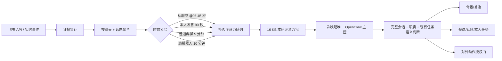

# 飞书注意力调度 V2

> 状态：已由[认知路由与渐进式上下文 V4](COGNITIVE_ROUTING_AND_CONTEXT_V4.md)取代。本文保留 V2 实测基线和迁移依据；“每批新建短会话”不再是现行设计。

## 目标

完整读取用户有权看到的信息，但不让每条消息都启动一次完整模型推理，也不让固定关键词或提及关系替 Agent 决定“是不是我的活”。

## 2026-08-12 基线

对当天已授权飞书消息做只读抽样统计：187 条消息分布在 22 个会话，其中 74 条单聊、113 条群聊、39 条本人发言、35 条机器人消息、2 条明确提及本人。这个规模适合按会话聚合，不适合按消息逐条唤醒。

同日运行日志显示 57 次完整采集，平均约 42 秒；近期 8 次 OpenClaw 轮次累计约 34 万 token，绝大多数是固定提示和缓存读取，许多轮次最终只返回极短结果。文档目录中少数频繁编辑的 Base 容器反复生成上百个索引版本，是主要虚假变化来源。

统计文件保存在 `runtime/analysis/feishu-conversation-baseline-20260812.json`，只用于本机诊断，不进入交接包。

## 新链路

## 关键规则

1. 消息全部保存；“没唤醒”不等于“没看见”。
2. 同一会话在未处理期间只有一个变化包，附带最多 100 条新增证据并保持时间顺序。
3. 新消息会延长普通会话的合并窗口，但不超过首条消息后的 10 分钟；私聊和 @我会把已有批次提前。
4. 提及本人、提及他人、本人发言、无明确责任人都是路由线索，不是任务归属结论。
5. Agent 可自主修改内部 Workboard，因为它可追溯、可撤销；外部回复、审批、文档修改、提交、部署和设备操作仍受权限门约束。
6. 唤醒直接运行同一个 OpenClaw Agent 会话，不依赖周期 Heartbeat；采集服务不等待模型完成，运行失败或仍有未确认变化时再退避补投。
7. ~~每个注意力批次使用独立短会话。~~ 此规则已废弃；V4.10 按人工主会话、真实 conversation 和隐藏 inbox 复用稳定会话，项目只作为软关系与检索作用域。Context Engine 使用固定协议投影并委托原生 compaction；注意力包最多返回 3 张未确认候选卡。
8. Codex 会话摘要仍保存助手结果和工具证据，但只有新增用户输入才进入注意力队列；助手继续执行产生的日志不得反向唤醒 Agent。

## 文档规则

- 文档目录证据按 token、标题、类型和 URL 去重，不使用 `edit_time` 生成无限版本。
- `edit_time` 只触发 Docx/Wiki 正文重新读取，正文以内容哈希去重。
- Base 容器编辑时间不等于表内业务记录变化；需要记录事件或明确配置的表游标才能触发业务判断。

## 预算目标

- 空闲 15 分钟：0 次模型调用。
- 一轮普通消息高峰：按会话数而不是消息数产生变化，最终合并为一次主控唤醒。
- 固定 Skill：显式白名单 6 个、描述预算不超过 5000 字符。
- OpenClaw 常驻工具：主控使用 `minimal + 显式允许`，日常路径不注入图像、视频、技能工坊、全量会话等无关工具；Codex 自身编程能力仍保留。
- OpenClaw 动态工具：当前生产使用通过 A/B 门禁的 `direct`；`searchable` 仅在隔离基准中评估。
- 日常语义判断：模型与思考等级从实时配置读取。生产控制轮无应用层总时长上限，每 60 秒只观察一次非终态状态；长编程任务由同一主控派发到独立 Codex child session。
- 单个变化包：最多 100 条证据，最终仍受插件总字节预算限制。

## 后续观察

部署后记录每日采集耗时、会话包数量、模型轮次、输入/缓存 token、待处理变化年龄和误建任务数量。连续三天根据真实分布调整冷却时间，不通过增加关键词规则弥补错误判断。

## 2026-08-12 实测

- 旧链路单次：4 次大范围读取，工具结果约 106 KB，44,215 token。
- 中间链路单次：26,748 token，仍误用了旧的 `focus + changes`。
- V2 链路单次：只调用 `shadow_attention_packet + shadow_context_ack`，工具结果约 10 KB，19,896 token；正确忽略烟雾测试且未新建卡片。
- 本地增量采集：约 6.4–11.6 秒；空闲采集不调用模型。

固定 Codex harness 仍占主要缓存输入，后续应观察真实飞书会话批次，不用牺牲语义判断换取极端低 token。当前优先收益来自“无变化零推理、按会话合并、无自激循环”。
